# doop 架构设计文档

| 项目     | 内容                                                                     |
| -------- | ------------------------------------------------------------------------ |
| 适用版本 | 根包 `0.10.0`，桌面壳 `0.7.0`                                            |
| 事实基线 | 提交 `a9659ae`（`main` 分支）                                            |
| 生成日期 | 2026-10-29                                                               |
| 文档定位 | 系统级架构总览，解释「由什么组成、边界在哪、数据怎么流、为什么这样决策」 |
| 维护方式 | 目录结构、模块边界、协议、数据表或部署形态变化时同步更新对应章节         |

本文只描述代码中实际存在的结构。所有结论都可以在仓库中找到对应文件；文中标注的路径均相对于仓库根目录。

---

## 目录

1. [文档定位与阅读指南](#1-文档定位与阅读指南)
2. [系统概览](#2-系统概览)
3. [系统上下文](#3-系统上下文)
4. [运行时拓扑与部署形态](#4-运行时拓扑与部署形态)
5. [仓库结构与依赖方向](#5-仓库结构与依赖方向)
6. [后端架构](#6-后端架构)
7. [前端架构](#7-前端架构)
8. [关键数据模型](#8-关键数据模型)
9. [关键端到端流程](#9-关键端到端流程)
10. [架构决策与权衡](#10-架构决策与权衡)
11. [质量属性与约束](#11-质量属性与约束)
12. [扩展指南](#12-扩展指南)
13. [已知技术债与演进建议](#13-已知技术债与演进建议)
14. [附录](#14-附录)

---

## 1. 文档定位与阅读指南

### 1.1 本文解决什么问题

doop 的架构知识此前分散在几类材料中：

- `CLAUDE.md` 与 `.context/TECHSTACK.md`：技术选型清单与局部实现说明；
- `.context/specs/`：单个功能的设计规格（原型、审批、版本、分享链接、工作区计费等）；
- `docs/`：集成与运维手册（Slack、Linear、Webhook、Gemini worker）；
- `README.md`：产品说明与 MCP 工具清单。

这些材料回答「用了什么」和「某个功能怎么设计」，但没有集中回答「系统整体如何分层、模块之间的依赖方向是什么、一次编辑从浏览器到数据库经过哪些环节、新代码应该放在哪里」。本文填补这一层。

### 1.2 目标读者

- 新加入的工程师：用一章建立完整心智模型，再按需深入源码。
- 功能评审者：判断一项改动是否跨越了既有边界、是否引入新的运行时假设。
- 接入本仓库的 AI Agent：在动手前确认模块归属与约束，避免在错误层次实现功能。

### 1.3 与其他文档的分工

| 文档                    | 回答的问题                                   | 不回答的问题           |
| ----------------------- | -------------------------------------------- | ---------------------- |
| 本文                    | 系统结构、边界、数据流、决策与权衡、扩展位置 | 单个功能的详细验收标准 |
| `.context/TECHSTACK.md` | 具体依赖版本、局部实现要点                   | 整体分层与依赖方向     |
| `.context/DESIGN.md`    | 设计令牌、组件目录、视觉规范                 | 前后端架构与数据流     |
| `.context/specs/`       | 单个功能的交互、数据字段、接口细节           | 跨功能的结构性约束     |
| `docs/*.md`             | 第三方集成的安装、配置与运维步骤             | 代码内部结构           |
| `README.md`             | 产品能力、MCP 工具清单、用户视角的使用方式   | 实现层结构             |

### 1.4 事实来源与时效

本文依据当前工作树的三路代码探查与源码抽查编写：服务端 `server/`、前端 `src/`、共享与工程基建 `shared/`、`desktop/`、`tests/`、`.github/`。行数、表名、消息名、工具数量等均以当前提交为准。

架构会演进。阅读时如果发现文中描述与代码不一致，应以代码为准，并更新本文对应章节；这也是本文的维护约定。

---

## 2. 系统概览

### 2.1 一句话定位

doop 是一个多人协作的设计画布：每条 Canvas 由若干 Page 和 Frame 组成，Frame 在沙箱 iframe 中渲染真实 HTML；人类在浏览器中编辑，AI Agent 通过内置 MCP Server 编辑，所有人通过每条画布一个 WebSocket 房间实时看到光标、在线状态、Frame 改动与活动流。

它同时是一个「设计文档运行时」：Frame 的 HTML 就是设计产物本身，画布负责摆放、缩放、协作与导出，而不是把设计转换成另一种私有图元格式。

### 2.2 核心概念

| 概念              | 含义                                                                | 主要定义位置                           |
| ----------------- | ------------------------------------------------------------------- | -------------------------------------- |
| Canvas            | 一张画布，是权限、协作、实时房间和分享链接的边界                    | `shared/types.ts` `Canvas`             |
| Page              | 画布内的页面分组；Frame 归属于某个 Page                             | `shared/pages.ts`                      |
| Frame（画板）     | 画布上的一个矩形区域，持有一段完整 HTML，在沙箱 iframe 中渲染       | `shared/types.ts` `Frame`              |
| Layer / Element   | Frame HTML 内部的 DOM 元素；通过 CSS selector 定位                  | `src/lib/layers.ts`                    |
| Frame 版本        | Frame HTML 的历史快照，按编辑突发分组保留                           | `server/db/schema.ts` `frame_versions` |
| Frame 审批        | 人对 Frame 的签核状态，用于自动化与交付门禁                         | `shared/types.ts` `FrameApproval`      |
| Presence          | 在线用户或 Agent 的实时状态（光标、视口、编辑中的 Frame、工作状态） | `shared/types.ts` `Presence`           |
| Agent Task / Card | 交给设计 Agent 的一次工作单元，通常对应一条反馈或一张看板卡片       | `shared/types.ts` `AgentTask`          |
| Activity          | 画布级活动流：谁创建、修改、评论、完成任务                          | `shared/types.ts` `ActivityItem`       |
| Share Link Role   | 分享链接的访问级别：`none` / `view` / `comment` / `edit`            | `shared/canvasRole.ts`                 |
| Design Memory     | 画布级设计知识与决策：guidelines、references、decisions、proposals  | `shared/types.ts` 与 `server/index.ts` |
| Automation        | 绑定在画布上的定时或审批触发的多步骤工作流                          | `shared/automations.ts`                |
| MCP               | Model Context Protocol；外部 Agent 通过它读写画布                   | `server/mcp.ts`                        |

### 2.3 五条关键设计假设

理解 doop 的架构，先理解它接受的五条假设：

1. **Frame 是可运行的 HTML 文档。** 任意用户 HTML、脚本、样式都可以进入 Frame。系统不解析、不规范化、不转换成私有图元；因此所有对 Frame 内容的读取和修改都必须发生在隔离环境中。
2. **画布是 HTML 文档的二维布局容器。** 画布只关心 Frame 的位置、尺寸、层级、页面归属；Frame 内部布局由浏览器自己负责。
3. **人类与 Agent 是同一等公民。** 两者走同一条 mutation 路径（`server/actions.ts`），共享同一套权限判定（`server/access.ts`）和同一套实时广播。
4. **协作是「实时在场 + 最终一致」。** 光标、视口、拖拽是高频广播；内容提交是 HTTP 写入；同一 Frame 的并发 HTML 编辑采用最后写入者胜，不做 OT/CRDT。
5. **单进程承载实时与持久化。** WebSocket 房间、在线状态、Agent 队列、自动化调度默认在一个进程内完成；多副本部署需要额外协调，只有自动化部分内建了跨副本 lease。

这五条假设解释了后文的大部分结构：沙箱 iframe、字符串形式的 frame runtime、内存优先存储、本地撤销、单例 WebSocket，都是它们的直接结果。

---

## 3. 系统上下文

下图给出系统边界、主要参与者与外部依赖。

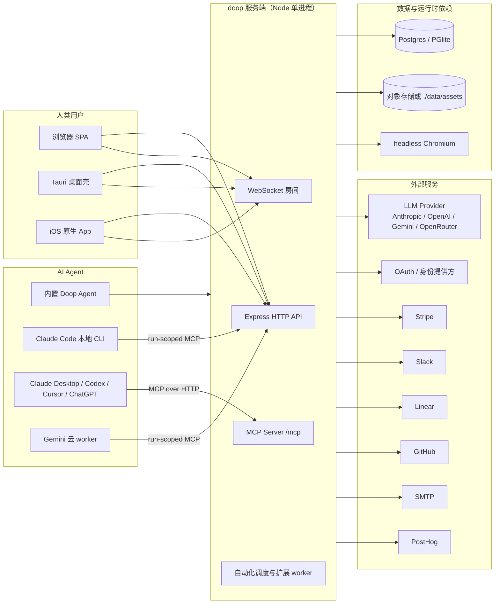

### 3.1 参与者

- **人类用户**：浏览器是主入口；Tauri 桌面壳加载同一托管站点，并增加本地能力（Claude Code、Codex 配置、窗口菜单、深度链接）；iOS App 复用同一 REST/WebSocket 契约，但用 Rust Blitz 渲染 Frame。
- **内置 Doop Agent**：服务端进程内的工具循环，代表某个用户（付费者）在画布上工作。
- **本地 Claude Code**：桌面 App 在本机运行 CLI，通过一次性的 run-scoped MCP 端点把工具调用回传给服务端；模型凭据不经过服务端。
- **外部 MCP 客户端**：Claude Desktop、Codex、Cursor、ChatGPT 等通过 `/mcp`、OAuth 或 Agent Key 接入。
- **Gemini 云 worker**：独立镜像中的官方 Gemini CLI，由服务端按用户路由任务，工具调用同样回传到服务端。

### 3.2 外部依赖与信任边界

| 依赖              | 用途                                   | 信任边界要点                                             |
| ----------------- | -------------------------------------- | -------------------------------------------------------- |
| LLM Provider      | Agent 推理与图像生成                   | 用户自带密钥或平台密钥；密钥只存在于服务端或本地壳       |
| 身份提供方        | 邮箱密码、OIDC、Google/Microsoft/Apple | better-auth 管理会话；MCP 另有 OAuth 授权服务器          |
| Stripe            | Team 订阅与席位计费                    | Webhook 以原始字节验签                                   |
| Slack / Linear    | 消息通知、问题创建、Agent 入口         | 各自 OAuth 安装，独立 worker 与持久化会话表              |
| GitHub            | 仓库导入与设计系统分析                 | PAT 或 GitHub App；仅 durable 权限者可配置               |
| SMTP              | 评论通知邮件                           | 2 分钟批量合并发送                                       |
| PostHog           | 产品分析与会话回放                     | 客户端经同源 `/relay` 代理，避免第三方脚本直接进入 Frame |
| headless Chromium | Frame 截图、PDF 导出、预览渲染         | 运行在服务端，加载用户 HTML，需与主进程隔离              |

---

## 4. 运行时拓扑与部署形态

### 4.1 单进程组成

生产环境是一个 Node 进程，内部同时承载 HTTP、WebSocket、MCP 和后台调度。

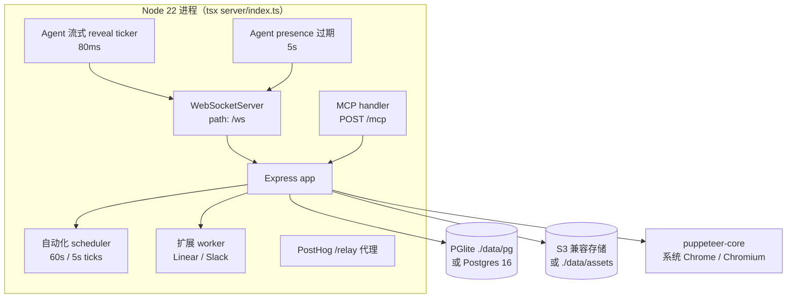

关键点：

- `server/index.ts` 是组合根（composition root），约 2373 行，负责进程启动、核心 REST 路由、WebSocket 房间、静态资源与生命周期。
- `actions.wire(broadcast, agentTouch)` 把房间广播和 Agent presence 注入 mutation 层，避免 `actions.ts` 反向 import `index.ts`。
- 自动化 scheduler 与扩展 worker 在 `server.listen` 回调中启动，确保端口就绪后才开始后台工作。
- 截图与 PDF 通过 `puppeteer-core` 调用系统 Chrome/Chromium（`CHROME_PATH` 或常见安装路径），不是内置浏览器。

### 4.2 两种数据库路径

| 模式       | 触发条件              | 驱动                                         | 适用场景                       |
| ---------- | --------------------- | -------------------------------------------- | ------------------------------ |
| 嵌入式     | `DATABASE_URL` 未设置 | `@electric-sql/pglite`，持久化到 `./data/pg` | 零配置本地开发、测试、单机体验 |
| 真实数据库 | `DATABASE_URL` 已设置 | `pg`                                         | Docker 自托管、生产部署        |

两条路径使用完全相同的 Drizzle schema 和迁移文件，迁移在 `initDb()` 启动时应用，绝不依赖 drizzle-kit 在部署阶段执行。

### 4.3 部署形态

| 形态             | 入口                                                     | 说明                                                                                 |
| ---------------- | -------------------------------------------------------- | ------------------------------------------------------------------------------------ |
| 浏览器 SPA       | `index.html` → `src/main.tsx`                            | Vite 构建到 `dist/`，Express 在生产环境提供静态文件与 SPA fallback                   |
| Docker 自托管    | `docker compose up`                                      | 应用容器（端口 4400）+ `postgres:16-alpine`；镜像构建用 Bun，运行用 Node 22 slim     |
| Tauri 桌面壳     | `desktop/src-tauri`                                      | 不打包前端，`frontendDist` 指向托管站点；独立版本号与发布流程                        |
| iOS 原生 App     | `ios/`                                                   | 复用 REST/WebSocket，Frame 由 Rust Blitz 渲染                                        |
| Gemini 云 worker | `workers/gemini/Dockerfile`                              | 独立进程，只复制必要的 `shared/` 与 `server/` 文件，通过 run-scoped MCP 回传工具调用 |
| 集成分发物       | `claude-extension/`、`cursor-plugin/`、`chatgpt-plugin/` | 只包含 manifest、MCP 地址与说明，不携带服务端代码                                    |

### 4.4 开发运行

`bun run dev` 同时启动：

- `tsx watch --env-file-if-exists=.env server/index.ts`：API 服务，默认端口 `4400`；
- `vite`：前端开发服务器，默认端口 `4300`；
- 构建 Claude Desktop 扩展包（`public/claude-extension/doop.mcpb`）。

Vite 代理下列路径到 Express：`/api`、`/mcp`、`/local-agent`、`/i/`、`/a/`、`/u/`、`/ingest`、`/relay`、`/blog`、`/robots.txt`、`/sitemap.xml`、`/.well-known`、`/ws`。其中 `changeOrigin` 故意关闭，让 better-auth 以 Web 源生成 OAuth 发现与授权 URL；`/i/` 必须带尾斜杠，避免吞掉 `/integrations`。

### 4.5 构建产物与版本标识

- 前端构建只产出 `dist/`，服务端 TypeScript 由 `tsx` 直接执行，没有独立编译产物。
- `server/index.ts` 在启动时对 `dist/index.html` 取哈希得到 `BUILD_ID`，通过 WebSocket `init` 消息的 `serverBuild` 字段下发。长期打开的浏览器或桌面窗口在重连时发现构建变化，会提示刷新。
- 根包、桌面壳、iOS 分别独立版本化；桌面壳可以在不重新打包前端的情况下立即获得线上更新。

---

## 5. 仓库结构与依赖方向

### 5.1 目录职责

| 目录                | 职责                                                             | 不允许做的事                               |
| ------------------- | ---------------------------------------------------------------- | ------------------------------------------ |
| `src/`              | React 单页应用：画布编辑器、仪表盘、设置、集成、认证页面         | 直接 import `server/`                      |
| `server/`           | Express、WebSocket、MCP、Agent、自动化、持久化、导出             | import `src/`；除 `shared/` 外依赖前端代码 |
| `shared/`           | 跨边界纯契约与纯函数：类型、协议、页面/角色/原型/自动化/计费定义 | 依赖 `src/` 或 `server/` 的运行时模块      |
| `desktop/`          | Tauri 2 Rust 壳与桌面专用命令                                    | 假设前端已打包进壳内                       |
| `ios/`              | SwiftUI App、BlitzKit（Rust HTML/CSS 渲染）                      | 复用 Web 前端的 DOM 代码                   |
| `workers/gemini/`   | Gemini 云 worker 镜像                                            | 加载完整的 `server/env.ts` 配置            |
| `claude-extension/` | Claude Desktop MCPB 扩展源码与打包脚本                           | 携带服务端实现                             |
| `cursor-plugin/`    | Cursor 插件与 marketplace 元数据                                 | 构建产物                                   |
| `chatgpt-plugin/`   | ChatGPT 插件 manifest 与打包脚本                                 | 构建产物                                   |
| `public/`           | 静态资源：嵌入同步脚本、图标、生成的扩展包                       | 被 TypeScript 直接 import                  |
| `scripts/`          | 构建扩展、文档检查、Stripe 初始化、批量导入等维护脚本            | 承载运行时业务逻辑                         |
| `tests/`            | 四层测试：纯单测、组件、真实服务集成、浏览器                     | 与生产代码共享可变状态                     |
| `.context/`         | 面向开发与 AI Agent 的上下文文档、规格、计划                     | 运行时读取                                 |

### 5.2 依赖规则

以下规则是当前代码的实际约束，也是新代码必须遵守的边界：

1. **`shared/` 是源码级共享，不是 workspace 包。** 它没有独立构建，没有路径别名，被 `src/` 与 `server/` 以相对路径直接 import。`tsconfig.json` 将 `shared` 纳入类型检查，Vite 将其打包进客户端，`tsx` 在服务端直接执行它，Docker 镜像必须把 `shared/` 复制进运行镜像。
2. **`server/` 不依赖 `src/`，`src/` 不依赖 `server/`。** 两侧只通过 HTTP、WebSocket、MCP 与 `shared/` 契约通信。
3. **`shared/` 不依赖任何一侧实现。** 它只包含类型、常量、纯函数和校验器。唯一的历史例外是 `shared/prototype.ts` 的解析器必须自包含，因为它的源码会被字符串内联进 frame runtime。
4. **扩展是单向依赖。** 核心只 import `server/extensions.ts`；`server/linear/` 与 `server/slack/` 可以自由 import 核心。删除某个扩展目录以及注册表中的一行，编译器会指出残留引用。
5. **Frame runtime 是字符串，不是普通模块。** `src/lib/frameRuntime.ts` 导出完整的 `FRAME_BOOTSTRAP` 字符串，拼接 replay/drop/proto 三个子 runtime；它不能 import 父窗口模块，所有能力必须在字符串内部自包含。

### 5.3 依赖方向

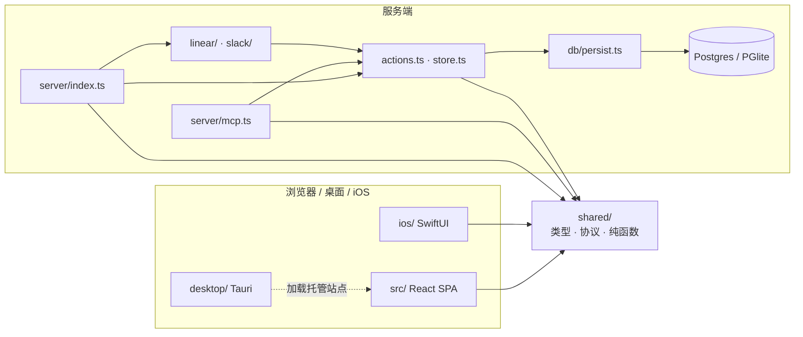

箭头表示编译期或运行时依赖方向。注意 `src/` 与 `server/` 之间没有箭头：它们的唯一连接是 `shared/` 契约和网络边界。

### 5.4 共享模块清单

| 模块                       | 内容                                                                | 使用方                       |
| -------------------------- | ------------------------------------------------------------------- | ---------------------------- |
| `shared/types.ts`          | 领域模型、WebSocket 协议、颜色、活动/评论/任务类型                  | `src/`（71 处）、`server/`   |
| `shared/pages.ts`          | 页面归属、旧版首页回退、页面变更合并                                | 前后端                       |
| `shared/prototype.ts`      | 原型交互属性、动作、过渡、解析器（会被内联进 runtime）              | 前后端 + frame runtime       |
| `shared/frameOrder.ts`     | 阅读顺序排序，用于 PDF 页序                                         | 前后端                       |
| `shared/pdfLimits.ts`      | PDF 帧数、并发、单帧超时、渲染预算                                  | 前后端                       |
| `shared/guides.ts`         | 标尺辅助线限制、校验、相等判断                                      | 前后端                       |
| `shared/viewport.ts`       | 对端视口校验，防止 NaN 变换                                         | 前后端                       |
| `shared/canvasRole.ts`     | 分享链接级别、角色归一化、`roleAllows`                              | 前后端                       |
| `shared/agents.ts`         | 常驻 Agent 角色、名称、颜色、prompt 摘要、流水线预设、@mention 解析 | 前后端                       |
| `shared/automations.ts`    | 调度、步骤、审批触发、运行状态、时区计算、校验                      | 前后端                       |
| `shared/modelMenu.ts`      | 精选模型菜单、推理强度、账户类型标签                                | 前后端                       |
| `shared/localAgent.ts`     | Claude Code 模型别名、pin 规则、effort、任务/结果形状               | 服务端 + Rust 壳校验         |
| `shared/billing.ts`        | 套餐词汇、席位价格、状态映射                                        | 前后端                       |
| `shared/comments.ts`       | 画布评论判定                                                        | 前后端                       |
| `shared/webhooks.ts`       | 出站 Webhook 事件名、标签、投递结果                                 | 服务端 + 前端设置页          |
| `shared/notifications.ts`  | 通知偏好                                                            | 前后端                       |
| `shared/desktopConnect.ts` | 桌面 OAuth 集成回跳协议                                             | 服务端 + 浏览器 relay + 桌面 |
| `shared/firstCanvas.ts`    | 注册后的首个画布落地路径                                            | 前后端                       |
| `shared/geminiCloud.ts`    | 云 worker 任务/结果 Zod schema                                      | 服务端 + worker              |
| `shared/agentActivity.ts`  | iOS Live Activity 紧凑线格式                                        | 服务端 + iOS                 |

`shared/` 的存在减少了最危险的一类不一致：同一条协议字段、同一种权限语义、同一份定价文案，在 HTTP/WS/iframe 两端各写一遍。

---

## 6. 后端架构

### 6.1 启动与生命周期

`server/index.ts` 是组合根。进程启动顺序如下，顺序本身是架构的一部分：

1. **环境解析**：import `server/env.ts` 时 `envalid` 立即校验约 110 个变量；非法配置在 HTTP 服务创建前就抛错。`BUILD_ID` 同时在此阶段从 `dist/index.html` 计算。
2. **数据库初始化**：`initDb()` 选择 PGlite 或 Postgres，并执行 `server/db/migrations` 中的迁移。
3. **背景图目录**：`backgrounds.initBackgrounds()`。
4. **认证实例**：`initAuth()` 构建 better-auth；必须在 `initDb()` 之后，因为 drizzle adapter 捕获的是已初始化的 `db`。
5. **管理员同步**：`syncAdmins()` 把 `ADMIN_EMAILS` 同步到已有账号的 `user.role`。
6. **状态水合**：`persist.hydrate()` 把画布、Frame、成员、指南、引用、任务、反馈、评论、活动、决策、提案加载进内存；空实例会先导入旧版 `store.json`。
7. **内存 Store**：`store.init(data.canvases)` 建立运行时状态，并修复 Page 已消失的 Frame。
8. **工作区与 Webhook 水合**：成员关系必须先于第一个请求，因为 `canvasRole` 会读取它。
9. **计费配置报告**：只记录 Stripe 配置状态，不阻塞启动。
10. **日志与中断恢复**：`actions.hydrateLogs(data)` 填充内存日志，并把上次进程中断时处于 claimed/running 的工作标记为失败。
11. **演示数据**：完全空的实例会 `seed()` 出 Welcome Canvas。
12. **排队任务重启**：对存在未领取卡片的画布，错峰调用 `resident.onFeedback(canvasId)`。
13. **资源引用重建**：`reconcileAssetRefs(frames)` 异步重建 `asset_refs`。
14. **进程安全**：`unhandledRejection` 只记录，不退出进程。
15. **优雅关闭**：`SIGINT`/`SIGTERM` 调用 `persist.flush()` 排空防抖写入，1.5 秒后强制退出。

关闭路径没有 `server.close()` 或 `wss.close()`，不会主动排空 HTTP/WebSocket 连接；这是当前实现的事实，部署时应把 SIGTERM 后立即断开视为预期行为。

模块级实时接线发生在 HTTP 服务创建之前：

- `conns: Map<WebSocket, Conn>` 保存所有房间连接；
- `actions.wire(broadcast, agentTouch)` 注入广播函数与 Agent presence 触摸函数；
- `onCanvasEvent(...)` 注册评论邮件与出站 Webhook 两个变更后监听器；
- 5 秒定时器清理过期的 Agent presence；
- `actions.ts` 内的 80ms reveal ticker 在 Agent 流式写入时广播渐进 HTML。

### 6.2 HTTP 层

#### 6.2.1 路由组织

服务端同时存在两种组织方式：

- **独立 Router 模块**：`/api/local-agent`、`/api/notifications`、`/api/webhooks`、`/api/admin`、`/api/community`、`/api/automations`、`/api/integrations`、`/api/workspaces`、`/api/live-activities`、`/api/billing`。
- **`server/index.ts` 内联路由**：画布、Frame、Page、评论、Agent 卡片等核心域，是最大的一处路由集合。

这种混合结构不是风格偏好，而是演进结果：外围域先被抽成 router，核心域仍留在组合根内。

#### 6.2.2 中间件顺序

顺序是刻意设计的，改动前必须理解每个位置的原因：

| 顺序 | 位置/中间件                                                | 为什么在这个位置                                                               |
| ---- | ---------------------------------------------------------- | ------------------------------------------------------------------------------ |
| 1    | `trust proxy`                                              | 反向代理后正确解析协议与客户端 IP                                              |
| 2    | `GET /healthz`                                             | 健康检查不需要数据库或会话                                                     |
| 3    | `/relay`                                                   | PostHog 会话回放是压缩二进制，必须在 `express.json` 之前                       |
| 4    | `GET /i/:id.:ext`、`/a/:id.:ext`、`/bg/:file`              | 公开图片与背景图，无需会话                                                     |
| 5    | `PUT /u/:token`                                            | 请求体就是文件，必须在 JSON 解析之前                                           |
| 6    | `/api/auth/*`                                              | better-auth 处理器必须先于会话门禁；同时有 MCP OAuth 与 impersonation 允许列表 |
| 7    | `POST /stripe/webhook`（`express.raw`）                    | 验签针对原始字节，且无会话                                                     |
| 8    | `/webhooks/<extension>`                                    | Linear/Slack Webhook 需要原始请求，先于 JSON 与会话                            |
| 9    | `express.json({ limit: '10mb' })`                          | 全局 JSON 解析                                                                 |
| 10   | `/gemini-cloud/mcp/:id`、`/local-agent/mcp/:id`            | 使用 run token 鉴权，先于 `/api` 会话门禁                                      |
| 11   | `/first-canvas`、`/api/account-exists`、`/api/oidc-config` | 注册前置与公开发现接口                                                         |
| 12   | `POST /ingest/:key`                                        | 自带解析器与 CORS 预检，供嵌入脚本使用                                         |
| 13   | `/api/integrations/:provider/callback`（桌面 relay）       | 必须在会话门禁之前完成回跳                                                     |
| 14   | `/api/live-activities` 请求日志                            | 在鉴权前记录                                                                   |
| 15   | `/api` 会话门禁                                            | 解析 better-auth 会话；无会话 401；impersonation 下所有非 GET 请求 403         |
| 16   | 各 Router 与内联路由                                       | 业务处理                                                                       |
| 17   | `app.all('/mcp')`                                          | MCP 自己处理鉴权，不走 `/api` 会话门禁                                         |
| 18   | `/.well-known/*`                                           | OAuth 授权服务器与受保护资源元数据                                             |
| 19   | `robots.txt`、`sitemap.xml`                                | 公开元数据                                                                     |
| 20   | `dist` 静态资源与 `app.get('*')` SPA fallback              | 最后兜底                                                                       |

一个值得记住的推论：**impersonation 只读**不是散落在各处理器的判断，而是 `/api` 会话门禁中的一条规则——所有非 GET 请求在 `session.impersonatedBy` 存在时返回 403。管理员因此可以查看任何画布，但不能代表用户写入。

#### 6.2.3 主要接口组

| 接口组           | 代表路径                                                                                     | 说明                                 |
| ---------------- | -------------------------------------------------------------------------------------------- | ------------------------------------ |
| 身份与账户       | `GET /api/me`、`/api/account-exists`、`/api/oidc-config`                                     | 当前用户、注册前置、OIDC 发现        |
| 认证与 MCP 同意  | `/api/auth/*`、`/api/mcp-consent/:code`                                                      | better-auth + MCP 授权同意           |
| 模型账户         | `/api/model-account`、`/api/model-account/models`、各类 BYO key 路由                         | 模型目录、选择、密钥、ChatGPT 设备流 |
| Agent 用量       | `GET /api/agent-allowance`                                                                   | 免费任务额度                         |
| 画布             | `/api/canvases`、`:id`、`duplicate`、`claim`、`publish`、`workspace`、`members`              | 生命周期、发布、空间归属、成员       |
| 设计记忆         | `:id/guidelines/:name`、`references`、`proposals/:pid`                                       | 指南、引用、提案                     |
| Page 与辅助线    | `:id/pages`、`:id/pages/:pageId/flow-start`、`:id/guides/:guideId`                           | 页面、原型起点、标尺辅助线           |
| Frame            | `POST /api/canvases/:id/frames`、`PATCH /api/frames/:id`、`append`、`DELETE`                 | 创建、更新、追加、删除               |
| Frame 审批与版本 | `PUT /api/frames/:id/approval`、`/versions`、`/versions/:id/restore`                         | 签核、历史、恢复                     |
| 评论             | `POST /api/frames/:id/comments`、`/api/canvases/:id/comments`、`replies`、`resolve`、`retry` | 元素评论、画布评论、回复、重试       |
| 导入             | `/api/canvases/:id/import/discover`、`/import`、`:id/github/*`                               | 网页与 GitHub 仓库导入               |
| Agent 卡片       | `POST /api/canvases/:id/cards`、`cards/:id/done`、`cards/:id/retry`                          | 看板工作流                           |
| 反馈             | `POST /api/tasks/:id/feedback`、`/api/feedback/:id/retry`                                    | 任务反馈与重试                       |
| 导出             | `GET /api/frames/:id/screenshot.png`、`GET /api/canvases/:id/export.pdf`                     | PNG 与 PDF                           |
| 工作区与计费     | `/api/workspaces/*`、`/api/billing/*`、`/stripe/webhook`                                     | 成员、邀请、订阅                     |
| 集成             | `/api/integrations/*`、扩展 Webhook、`/api/webhooks`                                         | Slack/Linear/GitHub/出站 Webhook     |
| 自动化           | `/api/automations/*`                                                                         | 工作流 CRUD、运行记录、手动触发      |
| 管理             | `/api/admin/*`                                                                               | 只读统计与管理（非管理员 404）       |
| 社区             | `/api/community`                                                                             | 公开作品列表与复制                   |

#### 6.2.4 校验与并发控制

校验体系是双轨的：

- 核心内联路由手写 `typeof` 判断、`String(...)`、`Number.isFinite`、长度上限和共享解析器（`parseGuide`、`parseListing`、`samePages`、`canvasPages`、`isLinkAccess`、`isPeerViewport`）。
- 较新的模块使用 Zod：`server/localAgent.ts`、`notifications.ts`、`webhookRoutes.ts`、`liveActivities.ts`、`modelCatalog.ts`、`geminiCloud*`、`extensions.ts`，以及全部 MCP 工具的 `inputSchema`。

并发控制有两处明确的乐观锁：

- Frame 的 PATCH/DELETE/审批接受 `expectedUpdatedAt`，版本不一致返回 409 和当前 Frame；
- Page 替换接受 `expectedPages`，不一致时拒绝覆盖。

#### 6.2.5 错误处理

没有全局 Express 错误中间件，也没有 `/api/*` 的 JSON 404 兜底。处理器要么本地 catch 并返回 `{ error: string }`，要么 `next(err)` 落到 Express 默认 HTML 错误页。内部使用若干具名错误类型（`PageLimitError`、`GuideLimitError`、`PdfRendererUnavailableError`、`WebhookInputError`、`OAuthStartError`、`StepError`、`AutomationPullError`、`ModelAuthError` 等）来区分可预期的失败。

### 6.3 实时层

#### 6.3.1 房间模型

- 一条画布对应一个隐式房间，没有显式的 `Map<canvasId, Set<Conn>>`；`room(canvasId)` 遍历 `conns` 过滤，复杂度是 O(总连接数)。
- `Conn` 保存 `ws`、`canvasId`、`userId`、`presence`、`silent`。
- 会话在升级连接时解析一次，但真正鉴权发生在客户端发送 `join` 时。未 `join` 的 socket 不会收到任何广播。
- `silent` 连接（管理员 impersonation）可以接收广播但从不发出，也不会出现在 presence 中。

#### 6.3.2 连接生命周期

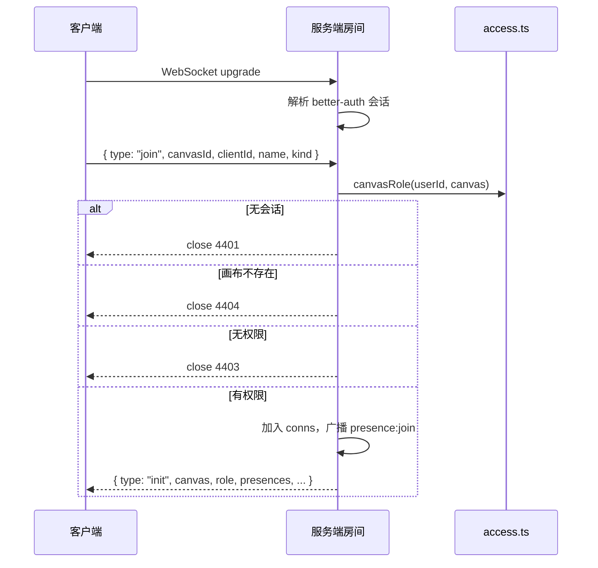

`refreshRoomRoles(canvasId)` 会在分享链接或成员关系变化后重新评估每个连接：下发新的 `role`、清除失去编辑权者的 editing 状态、必要时以 4403 关闭连接。

#### 6.3.3 协议

客户端 → 服务端只有 5 类消息：

| 消息         | 负载                                 | 所需角色 |
| ------------ | ------------------------------------ | -------- |
| `join`       | `{ canvasId, clientId, name, kind }` | `view`   |
| `cursor`     | `{ x, y }`                           | `view`   |
| `viewport`   | `{ viewport }`                       | `view`   |
| `editing`    | `{ frameId \| null }`                | `edit`   |
| `frame:drag` | `{ frameId, x, y, width, height }`   | `edit`   |

服务端 → 客户端 25 类消息，按用途分组：

- 初始化与角色：`init`、`role`；
- 在场：`presence:join`、`presence:leave`、`cursor`、`viewport`、`editing`、`status`；
- 协作产物：`task`、`feedback`、`comment`、`activity`；
- Frame：`frame:drag`、`frame:created`、`frame:updated`、`frame:deleted`、`frame:streaming`；
- 画布与 Page：`canvas:renamed`、`canvas:pages`、`canvas:deleted`；
- 设计记忆与辅助线：`guide`、`guidelines`、`reference`、`decision`、`proposal`。

协议定义在 `shared/types.ts` 的 `ClientMessage` 与 `ServerMessage` 联合类型中。

一个常被误解的点：**客户端不通过 WebSocket 提交 Frame 内容**。`frame:drag` 只是拖拽过程中的视觉广播；真正的提交走 REST 或 MCP，由服务端 `actions.ts` 统一广播 `frame:updated`。

#### 6.3.4 逐消息鉴权

`roomMessageNeeds(msg)` 定义每条客户端消息所需的最低角色：

- `join`、`cursor`、`viewport` → `view`；
- `editing`、`frame:drag` → `edit`；
- 未知或新增类型默认 `edit`（默认关闭）。

角色在每条消息到达时从会话重新读取，因此分享链接级别变化无需重连即可生效。

#### 6.3.5 在线状态

- **人类**：presence 挂在连接上，加入/离开时广播；颜色来自 `colorFor(clientId)`。
- **Agent**：`agentPresences: canvasId -> agentName -> presence` 是合成状态，任何工具调用都会 touch；TTL 20 秒，带有已发布状态的 Agent 为 60 秒。过期广播 `presence:leave` 并结束自动任务。
- **活动流**：`actions.logActivity` 写入有上限的内存日志，异步持久化并广播 `activity`；`init` 与 `/api/home/activity` 都会读取它。

#### 6.3.6 Agent 流式写入

流式不是模型客户端的职责，而是服务端架构的一等关注点：

- `append_frame_html` 维护 `streams` 映射，每个 chunk 广播部分 HTML；
- `set_frame_html` 使用 `reveals` ticker，每 80ms 广播一次渐进揭示，持续 2.5–5 秒；
- `healPartialHtml` 避免播放过程中出现破损标签或脚本；
- 空闲流 30 秒后关闭。

因此无论 Agent 使用哪个 provider，人类看到的都是同样的渐进渲染。

#### 6.3.7 断线与构建版本

- 客户端断线后固定 1200ms 重连，没有服务端事件重放或会话恢复；重连后重新 `join` 并收到完整 `init` 快照。
- 服务端不发送应用层 ping/pong，依赖 `ws` 协议与浏览器重连。
- `init.serverBuild` 是 `dist/index.html` 的哈希；客户端发现构建变化时提示刷新。
- 特殊关闭码：4401 会话失效（跳转登录）、4403 画布被锁定（回首页）、4404 画布不存在（显示未找到）。

#### 6.3.8 多副本约束

实时层是进程内状态：`conns`、presence、Agent presence、流式 reveal、自动化之外的 worker 队列都在单进程内存中。只有自动化通过数据库条件更新与 lease 支持多副本。部署多个服务端副本时，需要粘性路由或额外的房间协调层，否则在线状态与 Agent 扫描会分裂。

### 6.4 MCP Server

#### 6.4.1 挂载与传输

- 入口：`app.all('/mcp', handleMcpRequest)`，位于 `/api` 会话门禁之外，自行处理鉴权。
- 每个请求创建一个新的 `McpServer`，使用 `StreamableHTTPServerTransport({ sessionIdGenerator: undefined, enableJsonResponse: true })`；这是**无状态、JSON 响应**的传输，不是 SSE 长连接。
- 只接受 POST；GET 返回 JSON-RPC 405。
- 响应关闭时同时关闭 server 与 transport。

#### 6.4.2 鉴权路径

| 调用方       | 凭据                            | 解析方式                                          |
| ------------ | ------------------------------- | ------------------------------------------------- |
| Agent Key    | `Authorization: Bearer dpk_...` | `verifyAgentKey` 每请求解析所有者                 |
| OAuth 客户端 | better-auth MCP token           | `auth.api.getMcpSession`                          |
| 匿名发现     | 无                              | 仅允许 `ping`、`resources/list`、`resources/read` |
| 被禁用用户   | 任何仍有效的 token              | 403                                               |

未认证的工具调用返回 401，并在 `WWW-Authenticate` 与 `_meta['mcp/www_authenticate']` 中给出资源元数据与 scope。OAuth 同意页是 SPA 的 `/oauth/consent`，由 `/api/mcp-consent/:code` 的 GET/POST 支撑。发现元数据从 better-auth 桥接到 `/.well-known/oauth-authorization-server`、`/.well-known/openid-configuration`、`/.well-known/oauth-protected-resource[/mcp]`。

#### 6.4.3 工具清单

内置 38 个工具，按用途分组：

| 分组       | 工具                                                                                                                  |
| ---------- | --------------------------------------------------------------------------------------------------------------------- |
| 指南与灵感 | `get_guide`、`search_inspiration`                                                                                     |
| 账户与画布 | `list_canvases`、`get_profile`、`create_canvas`、`get_canvas`                                                         |
| 设计记忆   | `list_guidelines`、`get_guidelines`、`set_guidelines`、`get_reference`、`save_decision`                               |
| 在场与评论 | `set_status`、`get_comments`、`reply_to_comment`、`resolve_comment`、`get_feedback`                                   |
| 页面与原型 | `set_canvas_pages`、`get_prototype`、`set_prototype_start`                                                            |
| Frame      | `create_frame`、`get_frame`、`set_frame_html`、`append_frame_html`、`edit_frame_html`、`update_frame`、`delete_frame` |
| 导出与截图 | `export_frame`、`get_frame_screenshot`                                                                                |
| 资源与媒体 | `upload_asset`、`generate_image`、`search_images`、`list_backgrounds`、`search_icons`、`search_logos`                 |
| 网页       | `view_website`、`import_webpage`                                                                                      |
| 历史       | `list_frame_versions`、`restore_frame_version`                                                                        |

Linear 扩展额外注册 `list_linear_issues`、`get_linear_issue`；Slack 不提供 MCP 工具。每个工具都带 MCP 注解（`readOnlyHint`、`destructiveHint`、`idempotentHint`、`openWorldHint`）与 Zod `inputSchema`。

#### 6.4.4 资源

`server/chatgptApp.ts` 注册一个组件资源族：`ui://doop/frame-preview-<version>.html`，并保留已退役 URI 以兼容旧会话。它是 MCP Apps / ChatGPT 小组件（`text/html;profile=mcp-app`），用公开 `/i/` PNG 渲染 Frame 预览并返回 `structuredContent`。

#### 6.4.5 与 REST 共享服务层

MCP 工具直接调用 `actions.ts` 与 `store.ts`，与 REST 使用同一条 mutation 核心，因此广播、活动、presence、持久化行为完全一致。权限判定同样走 `canvasRole`；只读 Agent 不能领取工作、回复反馈或修改 Frame。Agent 身份通过 `resolveActor({ name, kind: 'agent', owner })` 构造。

### 6.5 Agent 子系统

#### 6.5.1 内置 Doop Agent

`server/resident.ts` 是一个服务端工具循环，事件驱动而非轮询：

- `onFeedback(canvasId)` 在卡片/反馈/评论变更后、有排队卡片的连接加入时、以及启动恢复时被调用；
- `sweep(canvasId)` 同一画布一次只跑一个 Agent；`running`/`queued` 是进程内集合；
- 工作选择顺序：`pendingWorkAgents` → `nextWorkPayer`，付款人是被领取请求的人类；
- 领取反馈、面向 Agent 的评论与排队卡片，设置状态与 presence，每 15 秒心跳；
- 循环形状对齐 Anthropic messages；`MAX_TURNS = 24`，重设计为 40，单次 sweep 最多 24 次运行；
- 结构化仓库卡片交给 `githubRecon.ts` 的 `runRepoCards`，不走普通聊天循环；
- 运行结束分类：完成、拒绝、崩溃、回合耗尽、无变更、未验证变更；失败可重试；
- 内置 23 个工具，覆盖 Frame 创建/检查/编辑/重写/截图、图像与素材搜索、网页导入、设计记忆、原型。

角色定义在 `shared/agents.ts`：Doop、UX Lead、Copywriter、Brand Compliance、Accessibility、Visual Polish，并提供流水线预设与 @mention 别名。

#### 6.5.2 模型路由

`pickModel(payerId)` 的解析顺序：

1. 运营方分配的 Gemini 云 worker；
2. 用户启用的本地 Claude Code，且桌面端在线；
3. 用户自己的 `model_account`：ChatGPT 订阅、OpenAI key、Anthropic key、OpenRouter key、Gemini key；
4. 服务端平台档位：`DOOP_AGENT_PROVIDER=anthropic`（默认）或 `azure`；
5. 都没有则返回 `null`，工作留在队列中并在被领取后显式失败。

一次运行只向一个人计费。连接模型账户会立即生效，而不是先消耗免费额度。

#### 6.5.3 Provider 适配

| Provider         | 实现文件                                         | 传输与要点                                                      |
| ---------------- | ------------------------------------------------ | --------------------------------------------------------------- |
| Anthropic        | `server/agentModel.ts`                           | SDK 流式、cache-control 断点、错误映射                          |
| OpenAI Responses | `server/openaiAgent.ts`                          | ChatGPT/Codex 后端 SSE、OpenAI key、Azure 部署三种传输          |
| OpenAI 兼容 Chat | `server/chatCompletionsAgent.ts`                 | OpenRouter 与 Gemini；固定 URL，避免用户提供 base URL 造成 SSRF |
| Claude Code 本地 | `server/localAgent.ts`、`localAgentRuns.ts`      | 桌面轮询任务，run-scoped token 回传工具调用；模型凭据不出本机   |
| Gemini 云 worker | `server/geminiCloudRuns.ts`、`geminiCloudMcp.ts` | 运营方路由，worker 回传工具调用；timing-safe token 比较         |

所有传输都使用 Anthropic 的消息/工具形状作为内部规范，因此新增 provider 的核心工作是实现 `run(req)` 或 `runHarness`，并在 `pickModel` 中增加分支。

#### 6.5.4 任务生命周期与流式回写

- 任务行保存在 `tasks` 表，同时有内存 `taskLog`（有上限）。
- 状态：queued（`agentName` 为空）、claimed、running（有状态文本）、completed、failed（`failedAt`/`failureReason`）。
- 进程启动时把中断的 claimed 工作标记为失败，避免永久「进行中」。
- 重试通过 REST 或 MCP 显式触发（`retryCard`、`retryComment`、`retryTaskFeedback`、`/api/feedback/:id/retry`）。
- Frame 写入经由 `actions.appendFrameHtml` / 渐进 reveal，与人类编辑共用广播路径。
- 截图由 `server/screenshot.ts` 的 `puppeteer-core` 完成。

#### 6.5.5 模型目录与计量

- `server/modelCatalog.ts` 用用户自己的密钥向 provider 拉取实时目录（Anthropic、OpenAI、Gemini、ChatGPT 订阅后端），再叠加 `shared/modelMenu.ts` 的精选条目作为 recommended；不可达时回退精选菜单并标记 `live: false`。
- 用户选择的模型与推理强度保存在 `model_accounts`；`MODEL_POLICY` 按 provider 形状校验 id。
- `server/allowance.ts` 管理免费任务额度（`RESIDENT_TASK_LIMIT`，默认 0），失败写入会退款；连接 MCP Agent 不提升额度，连接模型账户才提升。

### 6.6 自动化引擎

`server/automations.ts` 是后台工作流引擎，设计上明确支持多副本。

#### 6.6.1 调度与认领

- 调度 tick 每 60 秒：找出 `nextRunAt <= now` 的启用项，用条件更新认领：`UPDATE ... SET next_run_at = <next> WHERE id = ? AND next_run_at = <读到的值>`。多副本下只有一个能认领；崩溃只会丢掉这一次触发，不会留下卡住的行。
- 工作流 tick 每 5 秒：把有 `running` 运行的工作流、以及启用审批触发的工作流加入队列；进程内并发上限 4，并按自动化去重。

#### 6.6.2 Lease 与步骤

- `advanceRun(runId)` 通过 `leaseUntil = now + 300_000` 认领运行；后续所有保存都带同一 lease 条件，竞争 worker 无法交错写入。
- `finally` 释放 lease（置 0）；进程内 `running` 集合再做一层去重。
- 步骤类型：`agent`（排队看板卡片，任务与等待点同事务提交，等待最多 1 小时）、`pull`（Meta 广告素材）、`slack`、`linear`（交给扩展 `runAutomationAction`）。
- 审批触发在事务中认领 `automation_approvals` 唯一回执，重启或日志裁剪都不会重复派发；源 Frame 必须仍是 `ready_for_dev` 且未变化，单次最多 10 个源 Frame。
- 运行状态记录步骤、源、摘要、链接、`stepIndex`、`taskId`、`dispatching`；日志每个自动化保留 100 条；删除自动化会事务性取消运行并失败关联卡片。

#### 6.6.3 扩展钩子

`server/extensions.ts` 是扩展契约：`webhookRouter`、`startWorker`、`connectionStatus`、`oauth`、`connectRouter`、`canvasRouter`、`registerMcpTools`、`mcpGuideLines`、`runAutomationPull`、`runAutomationAction`。

其中 `canvasRouter` 与 `runAutomationPull` 已声明但当前没有任何挂载或调用点，属于未接线的历史钩子；`webhookRouter`、`connectRouter`、`registerMcpTools`、`runAutomationAction` 在使用中。

### 6.7 数据层

#### 6.7.1 表分组

| 分组         | 表                                                                                                                                                                                              |
| ------------ | ----------------------------------------------------------------------------------------------------------------------------------------------------------------------------------------------- |
| 认证         | `user`、`session`、`account`、`verification`、`oauth_application`、`oauth_access_token`、`oauth_consent`                                                                                        |
| 画布内容     | `canvases`、`frames`、`frame_versions`、`canvas_members`、`guidelines`、`guideline_versions`、`memory_references`、`decisions`、`memory_proposals`、`activity`、`comments`、`tasks`、`feedback` |
| 工作区与计费 | `workspaces`、`workspace_members`、`workspace_invites`                                                                                                                                          |
| 资源         | `assets`、`asset_refs`                                                                                                                                                                          |
| 同步与导入   | `sync_keys`、`sync_links`、`sync_edges`、`github_connections`、`integrations`                                                                                                                   |
| Agent        | `model_accounts`、`resident_usage`、`agent_keys`、`local_agent_preferences`、`image_prefs`、`notification_prefs`、`webhooks`                                                                    |
| 自动化       | `automations`、`automation_runs`、`automation_approvals`                                                                                                                                        |
| 消息集成     | `linear_installations`、`linear_oauth_states`、`linear_sessions`、`slack_installations`、`slack_oauth_states`、`slack_sessions`                                                                 |
| iOS 与素材库 | `live_activities`、`live_activity_starters`、`backgrounds`                                                                                                                                      |

#### 6.7.2 两种一致性模型

这是后端最重要的结构性分界：

| 模型                | 适用范围                                                                            | 实现                                                                    |
| ------------------- | ----------------------------------------------------------------------------------- | ----------------------------------------------------------------------- |
| 内存优先 + 异步写穿 | 画布、Frame、成员、任务、评论、活动、设计记忆                                       | `server/store.ts` 是读与广播的事实来源；`server/db/persist.ts` 异步镜像 |
| DB 优先 + 同步读写  | 工作区、计费、自动化、模型账户、Webhook、Live Activity、同步导入、Agent Key、背景图 | 路由模块直接用 Drizzle 查询                                             |

第一种模型让高频实时路径不必等待数据库；代价是持久化是最终一致的，进程崩溃可能丢失尚未 flush 的防抖写入。第二种模型让运营配置具备强一致读，但会把数据库延迟带进请求。

#### 6.7.3 持久化与水合

- `persist.hydrate()` 在启动时把协作内容整体加载进内存；`store.init()` 建立索引与不变量。
- 变更通过 `saveCanvas`、`saveFrame`（按 `frameTimers` 防抖，可立即写）、`saveTask`、`saveComment`、`saveActivity` 等写穿。
- 部分操作是事务性的：画布复制、Page 复制、版本写入。
- `persist.deleteCanvas` / `deleteFrame` 手工执行多表级联删除。

#### 6.7.4 迁移与约束

- 修改 `server/db/schema.ts` 或 `auth-schema.ts` 后运行 `npx drizzle-kit generate`，提交生成的 SQL 到 `server/db/migrations`。
- 迁移在 `initDb()` 启动时应用，PGlite 与 Postgres 共用同一套文件。
- 应用表**没有外键约束**（这是明确的设计选择），因为内存才是事实来源且写入异步；级联行为全部由 `persist.ts` 手工维护。新增表必须同时加入相关删除路径。
- `0000_init.sql` 是幂等基线，供迁移前数据库接入 journal；迁移 `0019` 为已延后的 Figma 集成保留，`0020–0022` 的 tag/时间戳保持不变；`0030` 记录已删除的 chat 消息。

### 6.8 横切关注点

#### 6.8.1 认证

- better-auth 1.6.26：邮箱密码、通用 OIDC/SSO、Google/Microsoft/Apple。
- 会话通过 cookie 解析，`/api` 门禁统一设置 `req.user` 与 `req.impersonatedBy`。
- MCP 使用 better-auth 的 `mcp` 插件作为 OAuth 授权服务器，另支持 Agent Key。
- iOS 使用与桌面相同的浏览器交接 + 原生 Apple 登录。

#### 6.8.2 授权

`server/access.ts` 与 `shared/canvasRole.ts` 是唯一的「此人能否做此事」判定源，被 REST、WebSocket、MCP 三处共用。

```ts
// server/access.ts
export function canvasRole(userId: string | undefined, canvas: Canvas): CanvasRole | null {
  if (!canvas.ownerId) return 'edit' // 无主/遗留画布可被认领
  if (!userId) return null
  if (hasDurableCanvasAccess(userId, canvas)) return 'edit'
  const link = canvas.linkAccess
  return link === 'view' || link === 'comment' || link === 'edit' ? link : null
}
```

派生判定：

- `canAccessCanvas`：角色非空；
- `canCommentCanvas`：至少 `comment`；
- `canEditCanvas`：至少 `edit`；
- `hasDurableCanvasAccess`：仅所有者、受邀成员、工作区成员，**不含任何分享链接访客**——用于同步密钥这类会长期有效的能力；
- `canManageCanvas`：所有者或工作区管理员；
- `isAdmin`：独立于 `canvasRole`，管理员通过 impersonation 进入画布，`session.impersonatedBy` 是审计线索。

#### 6.8.3 环境配置

- `server/env.ts` 使用 `envalid` 定义约 110 个变量，import 时一次性校验；空字符串视为未设置；生产要求 `BETTER_AUTH_SECRET` 与 `BETTER_AUTH_URL`。
- ESLint 禁止在 `server/env.ts` 之外读取 `process.env`。
- `.env.example` 是人工文档，并且有测试保证覆盖一致。
- Gemini worker 是唯一不加载完整 env schema 的进程，只带自己的小配置面。

#### 6.8.4 日志与可观测性

- 日志是带 `[component]` 前缀的 `console.log` / `console.error`；没有结构化日志、请求 ID 或日志级别。
- 服务端 PostHog 通过 `server/analytics.ts` 采集，客户端经同源 `/relay` 代理。
- 唯一健康检查是 `GET /healthz`；没有 metrics、Prometheus、OpenTelemetry 或 tracing。
- Agent 运行的主要观测信号是 `[resident] run end ...` 日志行。

#### 6.8.5 限流

所有限流都是进程内内存态，重启即重置，多副本不共享：

| 对象                    | 位置                  | 规则                          |
| ----------------------- | --------------------- | ----------------------------- |
| MCP 上传/搜索/生成/导入 | `server/mcp.ts`       | 环境变量按分钟配置            |
| 网页/GitHub 导入        | `server/index.ts`     | 每用户 5 次/分钟              |
| 预览渲染                | `server/previews.ts`  | 按 IP；认证用户在耗尽后仍可用 |
| PDF 导出                | `server/pdfExport.ts` | 每用户 1 次/分钟              |
| 设计同步 ingest         | `server/ingest.ts`    | `SYNC_INGESTS_PER_MIN`        |

#### 6.8.6 文件与导出

- 上传：`server/assets.ts` 限制 5 MB，用 `sharp` 嗅探 MIME，写入 S3 兼容存储或 `./data/assets`；`asset_refs` 从 HTML 中提取。
- 两条上传路径：浏览器 `POST /api/canvases/:id/assets` 与 Agent 一次性票据 `PUT /u/:token`（15 分钟 TTL）。
- PNG/JPG：`server/screenshot.ts` 用系统 Chrome 渲染 Frame。
- PDF：`server/pdfExport.ts` 让 headless Chrome 按每个 Frame 自身的页面尺寸打印，再用 `pdf-lib` 合并；受 `shared/pdfLimits.ts` 限制（最多 40 帧、并发 3、单帧 60 秒）。
- 预览与缩略图：`server/previews.ts` + `thumbs.ts`，进程内缓存 + 持久化缩略图 + stale-while-revalidate。

#### 6.8.7 外部集成与安全

- 出站 Webhook：`server/webhooks.ts` 对私有/环回地址做初次与投递时的 DNS 复查，HMAC-SHA256 签名，内存重试，连续失败 100 次后禁用。
- 评论邮件：`server/commentNotifications.ts` 按 2 分钟批量合并，内存态。
- iOS Live Activity：`server/liveActivities.ts` + `apns.ts`，去重 token 存数据库。
- 计费：`server/billing.ts` 封装 Stripe checkout、portal、席位同步与 Webhook 验签。

---

## 7. 前端架构

### 7.1 启动与会话

启动顺序有三个必须保持的阶段：

1. **主题预绘制**：`index.html` 内联脚本读取 `localStorage['doop-theme']`，在 CSS 加载前给 `<html>` 加上 `.dark` 并设置 `color-scheme`，避免首屏闪烁。`src/lib/theme.ts` 在 React 启动后接管同一键。
2. **模块级初始化**：`src/main.tsx` 依次 import `src/lib/posthog.ts`（副作用初始化）、`initDesktopShell()`（桌面壳全局与深度链接）、`initTheme()`，然后挂载 React。
3. **会话门禁**：`App` 使用 better-auth 的 `authClient.useSession()`。未登录时除桌面交接页与 OAuth 同意页外，所有路径渲染 `AuthPage`；`/c/...` 保留原 URL，以便登录后回到深链。

根组件树很薄：`StrictMode → TooltipProvider → App`。没有全局数据 Provider，认证、store 与实时连接都是模块级单例。

### 7.2 路由

前端没有使用路由库，`src/App.tsx` 手写匹配：

- `route = location.pathname + location.search`，`popstate` 更新；
- `src/lib/navigate.ts` 是唯一导航原语：`history.pushState` + 合成 `PopStateEvent`；
- 页面全部静态 import，没有 `React.lazy` 或路由级代码分割。

路由表（按匹配优先级）：

| 路径                     | 页面                | 说明                |
| ------------------------ | ------------------- | ------------------- |
| `/desktop/connect/codex` | `DesktopCodexSetup` | 桌面 Codex 安装确认 |
| `/desktop/signin`        | `DesktopSignIn`     | 浏览器登录交接      |
| `/desktop/connect`       | `DesktopConnect`    | 集成 OAuth 回跳     |
| `/c/:id/proto`           | `PrototypePage`     | 全屏原型播放        |
| `/c/:id`                 | `CanvasPage`        | 画布编辑器          |
| `/oauth/consent`         | `OAuthConsent`      | MCP 授权同意        |
| `/admin/*`               | `Admin`             | 管理后台            |
| `/settings/*`            | `Settings`          | 个人与工作区设置    |
| `/community/*`           | `Community`         | 公开作品社区        |
| `/integrations/*`        | `Integrations`      | 集成管理            |
| `/w/:id`                 | `Workspace`         | 工作区              |
| `/automations/:id`       | `AutomationEditor`  | 自动化编辑器        |
| `/automations/*`         | `Automations`       | 自动化列表          |
| 其他                     | `Home`              | 首页                |

手写路由的代价是匹配逻辑在 `App.tsx`、`CanvasPage`、桌面模块与各页面中重复；收益是没有额外依赖，并且可以在 `pushState` 之外精确控制深链清理、桌面接管与未登录兜底。

### 7.3 状态管理

#### 7.3.1 主 Store

`src/lib/store.ts` 是一个 Zustand store，约 735 行，承载整个画布会话。按域划分：

| 域        | 内容                                                                                                                                           |
| --------- | ---------------------------------------------------------------------------------------------------------------------------------------------- |
| 画布数据  | `canvas`（含 `frames`、`pages`、`guides`）、`activePageId`                                                                                     |
| 在场      | `presences`、`cursors`、`following`、`connected`、`canvasNotFound`、`updateReady`                                                              |
| 协作产物  | `activity`、`tasks`、`feedback`、`comments`、`decisions`、`proposals`                                                                          |
| 选择      | `selectedIds`、`selectedId`、`selectedElement`、`selectedElements`、`hoveredLayer`                                                             |
| UI/chrome | `tool`、`panMode`、`inspectorOpen`、`elementPanelOpen`、`layersOpen`、`prototypeMode`、`panelTab`、`rulers`、`uiHidden`、`notice`、`limitWall` |
| 相机      | `viewport {x, y, zoom}`、`snapGuides`、`flyTo`、`threadRequest`、`composerFocusAt`、`composerDrafts`                                           |
| 效果      | `flashes`（远端修改高亮）、`streams`（Agent 正在写入的 Frame）                                                                                 |

Action 覆盖所有域，并提供 `select`/`toggleSelect`/`selectMany`、`pickElement`/`toggleElement`、`setRole`（降级工具与面板）、`requestFlyTo`、`requestOpenThread`、`flash`、`setStream` 等。导出的辅助函数 `pickedSelectors`、`roleOf`、`canEditOpenCanvas`、`canCommentOpenCanvas`、`toolAllowed` 让 UI 不必重复权限判断。

只有 `layersOpen`（`doop:layers-open`）与 `rulers`（`doop:rulers`）由 store 持久化；相机不持久化。

#### 7.3.2 其他 Store 与持久化

| Store/模块                  | 职责                        | 持久化键                  |
| --------------------------- | --------------------------- | ------------------------- |
| `src/lib/desktop.ts`        | 桌面标签栏 `useTabs`        | `doop-open-tabs:<userId>` |
| `src/lib/frameSaves.ts`     | 每个 Frame 的进行中保存计数 | 无                        |
| `src/lib/localAgent.ts`     | 本地 Claude Code 状态       | 无                        |
| `src/lib/railDrawer.ts`     | 移动端侧栏抽屉              | 无                        |
| `src/components/Rulers.tsx` | 辅助线拖拽状态              | 无                        |

其他 localStorage 键包括：主题 `doop-theme`、侧栏 `doop-rail`、面板宽度 `doop:canvas-panel-widths`、元素面板标签 `doop:element-panel-tab`、HTML 检查器 `doop:inspector-html`、身份 `doop:clientId`/`doop:name`、剪贴板 `doop:frame-clipboard`/`doop:element-clipboard`、首页草稿 `doop-home-drafts` 等。键前缀存在 `doop:` / `doop-` / `doop.` 三种写法，是历史遗留，不要把它当作稳定 API。

#### 7.3.3 服务端数据获取

没有 React Query 或 SWR：

- `src/lib/api.ts` 提供 `req<T>()` 包装（JSON、`ApiError` 带 status/body）和覆盖全部域的 `api` 对象，另有 `adminApi`；`paywalledWorkspace(err)` 把 HTTP 402 映射为升级弹窗。
- 页面在 `useEffect` 中用局部 `useState` 拉取，加载/错误/重试模式在各页面重复。
- 认证用 better-auth；`src/lib/me.ts` 的 `useMe(userId)` 有模块级缓存与 3 秒重试。
- 变更通常是「乐观更新 store → 调用 `api.*`」，用 `trackSave()` 记录撤销，用 `beginFrameSave()` 标记未完成写入。

### 7.4 画布渲染模型

这是前端最核心、也最不常规的部分。

#### 7.4.1 世界、相机与缩放

- 视口是屏幕像素坐标 `{x, y, zoom}`；世界坐标 = `(client - stageRect - viewport) / zoom`。
- 缩放范围 8%–1600%。
- `.world` 元素同时使用 CSS `zoom` k 与 transform：
  - `world.style.zoom = layoutZoom`（Chromium 会把 k 传给 frame iframe 作为像素密度）；
  - `world.style.transform = translate(vp.x / k, vp.y / k) scale(vp.zoom / k)`。
- `src/lib/layoutZoom.ts` 把 k 取整或取 float32 稳定值，保证 Chromium 与 WebKit 的 CSS zoom 行为一致；非 Chromium 引擎下 `FrameView` iframe 用 `zoom: 1/k` + `scale(k)` 反向抵消。
- **平移与缩放不触发 React 渲染**：`Stage` 用 `useStore.subscribe` 在 `useLayoutEffect` 中直接写 world transform、点阵背景位置/尺寸、像素网格、`--zoom`/`--vx`/`--vy` 与缩放标签。
- 滚轮用 rAF 批处理；触控板捏合有独立的非 passive 监听；平移支持 Hand 工具、空格与中键。
- 相机辅助：`fit()`、`fitSelection()`、`zoomCentered()`、700ms `flyTo` 动画、深链（`?frame`、`?selector`、`?comment`、`?page`）、跟随对端视口的缓动循环。

#### 7.4.2 Frame 与 iframe 沙箱

- 每个 Frame 是绝对定位的 `div`，按 `frame.x/y/width/height` 放在世界坐标中。
- 内部是一个 `<iframe sandbox="allow-scripts" srcDoc={FRAME_BOOTSTRAP}>`；HTML 通过 `postMessage` 投递，**从不导航**。`useThrottledValue(frame.html, 150)` 限制重投频率。
- iframe 是不透明源（opaque origin），父窗口无法读取其 DOM。因此所有命中测试、样式读取、结构检查都必须由 frame runtime 在 iframe 内完成，再通过消息返回。
- 一个透明「shield」覆盖 iframe，编辑模式下才移除，使指针事件能到达父窗口。
- Frame 名称标签被 portal 到屏幕空间层（`FrameLabelLayer`），因此在任何缩放下都保持屏幕尺寸与清晰文字。
- 每个 Frame 的视觉状态：选中描边、远端编辑者描边、Agent 流式虚线边、远端更新闪烁、锁定/同步/GitHub/审批徽标。

#### 7.4.3 Frame Runtime 与桥协议

`src/lib/frameRuntime.ts` 导出 `FRAME_BOOTSTRAP`，是一个模板字符串形式的完整 iframe runtime，拼接：

- `FRAME_REPLAY_RUNTIME`（会话回放桥）；
- `FRAME_DROP_RUNTIME`（拖放）；
- `FRAME_PROTO_RUNTIME`（原型触发）。

Runtime 的职责：

- **DOM morph**（`syncAttrs` / `morphChildren`），而不是整页重渲染；变化脚本会重新执行；样式、textarea、iframe、foreign content 按不透明内容处理；
- **行内编辑**：`contenteditable`、光标放置、`doop:edited` 序列化；
- **序列化**：去掉 runtime 标记（`data-v-*`）并重新输出 `<!doctype html>`；
- **命中测试**：`elementsFromPoint`、`cssPath()` 选择器、`probe`、`hoverProbe`、`contextHit`、`drawingHit`、`moveHit`、`locate`、`pathInfo`；
- **元素检查与写入**：计算样式 → `ElementInfo`；样式写入；几何编辑（移动/定位/对齐/旋转/翻转）；样式手势 `begin`/`commit`/`cancel`，用于实时预览后一次提交；
- **图层状态**：把隐藏/锁定镜像为 `data-doop-hidden` / `data-doop-locked`；
- **原型**：扫描触发器和动作。

父窗口侧 `src/lib/frameBridge.ts` 维护注册表：

- `registerFrameWindow(frameId, win)` / `unregisterFrameWindow`；
- `requestFrame(frameId, type, payload)`：2 秒超时、`reqId` 关联、来源窗口校验、回复类型校验；
- 类型化包装：`inspectElement`、`styleElement`、`replaceElementImage`、`editElementGeometry`、`elementMoveTarget`、`styleGesture`、`scanHotspots`、`onFrameChange`。

消息协议（节选）：

| 方向       | 消息                                                                                                                                                                                                                                                                                                                                                                        |
| ---------- | --------------------------------------------------------------------------------------------------------------------------------------------------------------------------------------------------------------------------------------------------------------------------------------------------------------------------------------------------------------------------- |
| 父 → Frame | `doop:inspect`、`doop:style`、`doop:replace-image`、`doop:geometry`、`doop:style-gesture`、`doop:html`、`doop:edit`、`doop:visibility`、`doop:lock`、`doop:probe`、`doop:context-hit`、`doop:drawing-hit`、`doop:move-hit`、`doop:move-target`、`doop:path`、`doop:path-editing`、`doop:hover`、`doop:select`、`doop:code`、`doop:locate`、`doop:proto-scan`、`doop:replay` |
| Frame → 父 | `<type>-result`（同 `reqId`）、`doop:frame-ready`、`doop:frame-updated`、`doop:edited`、`doop:edit-esc`、`doop:esc`、`doop:active`、`doop:context-menu`、`doop:proto-action`                                                                                                                                                                                                |

这套协议的代价是消息名散落在 `frameRuntime.ts`、`FrameView.tsx`、`frameBridge.ts` 与各覆盖层中，而且 runtime 本身不在 TypeScript 类型检查范围内。

#### 7.4.4 选择与命中测试

- 元素命中在 iframe 内完成，父窗口只根据返回矩形绘制描边。
- 单击流程：pointerup 且未拖动 → 延迟 250ms 的 `probeAt`（避免双击闪烁）→ runtime `doop:probe` → `pickElement` + 元素工具条。
- Hover：约 40ms 节流 `doop:hover`，命中 tag/rect 变化才重渲染。
- 图层面板通过 `doop:select` / `doop:locate` 解析实时元素。
- 框选：世界矩形与 Frame 矩形求交，跳过隐藏/锁定 Frame。

#### 7.4.5 其他编辑器表面

| 表面       | 文件                                            | 要点                                                                                  |
| ---------- | ----------------------------------------------- | ------------------------------------------------------------------------------------- |
| 图层面板   | `LayersPanel.tsx`、`lib/layers.ts`              | 父窗口解析保存的 HTML 为 `LayerNode[]`；支持选择、锁定、隐藏、拖拽重排/重父           |
| 设计面板   | `ElementPanel.tsx`                              | Design/HTML 两个标签；计算样式读取、内联样式写入、数值拖拽、flex 控件、700ms 自动保存 |
| 检查器     | `Inspector.tsx`                                 | Frame 名称/坐标/尺寸、HTML 自动保存、锁定/可见、审批、导出、历史                      |
| 原型覆盖层 | `PrototypeOverlay.tsx`、`lib/prototype.ts`      | 扫描热区、世界坐标连线、流程起点、拖拽连线                                            |
| 路径编辑器 | `PathEditor.tsx`、`lib/pathEditing.ts`          | 原生 SVG path 锚点与 Bezier 手柄编辑；409 冲突时重载                                  |
| 评论       | `CanvasComments.tsx`、`CommentPopovers.tsx`     | 元素锚定与画布锚定；pin 通过 `doop:locate` 定位                                       |
| 原型播放器 | `PrototypePlayer.tsx`、`lib/prototypePlayer.ts` | 全屏沙箱 Frame、历史栈、过渡、键盘动作、URL 同步                                      |

### 7.5 交互手势

`src/lib/tools.ts` 定义底部工具栏工具与快捷键；`resolvePointerAction()` 是唯一的「这次指针该做什么」决策表。Space/中键平移优先于绘制。

| 手势            | 实现                                  | 提交语义                                                      |
| --------------- | ------------------------------------- | ------------------------------------------------------------- |
| Frame 移动/缩放 | `FrameView.startDrag`                 | 拖拽中节流广播 `frame:drag`；释放时 PATCH + 一条撤销记录      |
| 多选移动        | `FrameView` 携带整个选择              | 锁定 Frame 不动；⌥⇧ 拖拽复制                                  |
| 元素移动        | `ElementMove.tsx`                     | 异步命中测试 → style gesture 预览 → 提交或跨父级 drop         |
| 元素缩放        | `ElementResizeHandles.tsx`            | 计算尺寸而非视觉尺寸；Shift 保持比例；Esc 取消                |
| 绘制            | `CanvasDrawing.tsx`、`lib/drawing.ts` | 矩形/圆/路径/文本/空 Frame；追加到已有 Frame 或新建独立 Frame |
| 路径编辑        | `PathEditor.tsx`                      | 锚点/手柄拖拽、角点/曲线切换、删除；每次完成编辑一条撤销      |
| 辅助线          | `Rulers.tsx`、`lib/guides.ts`         | 从标尺拖出、拖动、删除；按 guide id 串行写入                  |
| 吸附            | `lib/snap.ts`                         | 8 屏幕像素容差；Alt 绕过；标尺辅助线参与                      |

异步手势是前端复杂度的主要来源：元素移动与命中测试都要等 iframe 回复，期间指针事件被缓冲；Frame HTML 或选择在手势中变化时必须取消并恢复。新增手势应复用既有手势状态机，而不是再写一套。

### 7.6 撤销与重做

`src/lib/history.ts` 是**客户端本地**历史，只回放当前客户端自己的操作，远端变更永远不会被撤销。

- 条目类型：`update`、`create`、`delete`、`pages`、`guide`、`transfer`、`group`（可带顺序）。
- 最多 100 条；同一 Frame/字段的连续 `update` 在 1500ms 内合并。
- `trackSave(promise)` 让撤销/重做等待进行中的拖拽保存，避免逆操作与保存竞态。
- 撤销通过正常 API 重放逆操作，因此协作者能看到变化。
- 删除的 Frame 重建后获得新 id，`remapId()` 会重写所有历史条目。
- Page 变更带前置条件（`PrerequisiteFailed`、ordered group），保证 Frame 不会落到错误页面。
- `clearHistory()` 提升 epoch，使迟到的保存失效。

### 7.7 实时客户端

`src/lib/ws.ts` 是模块级单例：

- `connect(canvasId)` 打开 `ws(s)://<host>/ws`；`disconnect()` 关闭；`sendWs(msg)` 在 open 时 JSON 编码发送。
- 打开后立即发送 `join`，然后设置 `connected: true`；先 join 是为了让 Stage 只能在服务端认识画布后宣布相机。
- 收到消息进入单一 `handle(msg)` switch，直接写 store。
- 意外关闭后固定 1200ms 重连；4401 刷新到登录、4403 回首页、4404 设置 `canvasNotFound`。
- `init.serverBuild` 与页面首次加载的构建不同则设置 `updateReady`，由 CanvasPage 提示刷新。

presence 渲染：

- `Cursors.tsx` 绘制 SVG 光标与名字气泡，隐藏其他 Page 的对端，按 `--zoom` 反向缩放；
- `LivePresence.tsx` 是中心在场胶囊：自己的头像、对端头像堆叠、轮播的 Agent 状态、在线人数；
- `PeerAvatars.tsx`、`WorkingNow.tsx`、`GhostFrames.tsx` 显示 Agent 占位与工作状态；
- 跟随模式由工具栏或对端操作触发，任何手动相机移动都会清除。

### 7.8 设计系统与组件约束

`src/components/ui/` 有约 51 个 shadcn/Radix 包装与设计系统原语；`src/styles.css` 用 CSS 自定义属性定义令牌，并通过 Tailwind 4 `@theme` 映射。完整令牌与组件目录见 `.context/DESIGN.md`。

约束不是约定，而是 lint 强制：

- `eslint.config.js` 的 `no-restricted-syntax` 对 `src/pages/**`、`src/components/**`、`src/integrations/**` 禁止裸 `<button>`/`<input>`/`<select>`/`<textarea>`、`role="button"`/`role="link"`、任意 `text-[…]`/`rounded-[…]`、Tailwind 默认字号与圆角、`leading-[…]`/`tracking-[…]`、`font-bold` 及以上、以及十六进制颜色；
- `src/components/ui/**` 与 `LEGACY_CHROME` 列表中的编辑器文件豁免；
- `LEGACY_CHROME` 的注释明确写着「Add nothing new here」，表示编辑器 chrome 尚未完成迁移。

Storybook 复用应用 Vite 配置，`src/stories/` 有 Foundations、Primitives、Marks、Shell 等页面；新原语必须带 story。

### 7.9 桌面与 iOS 集成

#### 7.9.1 Tauri 桌面壳

- 壳不打包前端：`frontendDist` 指向托管站点，因此线上发布立即到达已安装应用。
- Rust 在 webview 初始化前注入全局标记：`__DOOP_DESKTOP__`、`__DOOP_DESKTOP_PLATFORM__`、`__DOOP_CLAUDE_CLI__`、`__DOOP_CLAUDE_INSTALL__`、`__DOOP_CLAUDE_EXTENSION__`、`__DOOP_CODEX_SETUP__`、`__DOOP_VIEW_MENU__`。
- 前端通过 `src/lib/shell.ts` 做能力探测（版本 + 平台），而不是只依赖版本号。
- 本地 Claude Code：`claude.rs` 寻找最新 CLI（≥ 2.1.0），`claude_run` 启动 `claude -p` stream-json，校验 run id/token/model/effort，剥离继承的 API key 环境变量。
- Codex：`codex.rs` 用 `toml_edit` 幂等写入 `~/.codex/config.toml`，保留注释与其他 server，冲突时拒绝。
- 深度链接：`doop://auth`、`doop://integration/<id>`、`doop://connect/codex`。
- macOS View 菜单：Rust 发送 `view-command` 事件，页面通过 `view_menu_state` 回写勾选状态；只有 ⌘ 快捷键在菜单中绑定。
- 导航允许列表把应用域和 `about:`/`blob:` 留在 webview，其余 http(s) 与 `mailto:`/`tel:` 交给系统打开。

#### 7.9.2 iOS

- 原生 SwiftUI App，复用 REST + WebSocket 契约；`DoopClient.swift` 与 `CanvasModel.swift` 是主要接入点。
- Frame 由 Rust Blitz 引擎通过 C ABI 渲染（`ios/BlitzKit/rust`），不是 WebKit。
- 登录复用桌面浏览器交接模式，同时支持原生 Apple 登录。
- Live Activity 使用 `shared/agentActivity.ts` 的紧凑线格式，服务端经 APNs 投递。

---

## 8. 关键数据模型

应用表没有外键约束，下图的关系是逻辑关系，由 `server/db/persist.ts` 的写入与删除路径维护。

### 8.1 身份、画布与协作内容

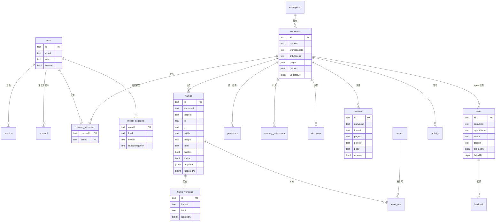

要点：

- `canvases.pages` 与 `canvases.guides` 是 `jsonb`，Page 与辅助线不单独成表；Frame 通过 `pageId` 归属。
- 时间戳统一是 epoch 毫秒的 `bigint`。
- `canvas_members` 不包含所有者；所有者由 `canvases.ownerId` 表示。
- 评论有两种锚定方式：元素评论有 `frameId` + `selector`/snippet，画布评论有 `pageId` + 坐标。
- 审批状态是 Frame 上的 `jsonb`，版本历史则是独立的 append-only 表，并按 Frame 裁剪。

### 8.2 工作区、自动化与集成

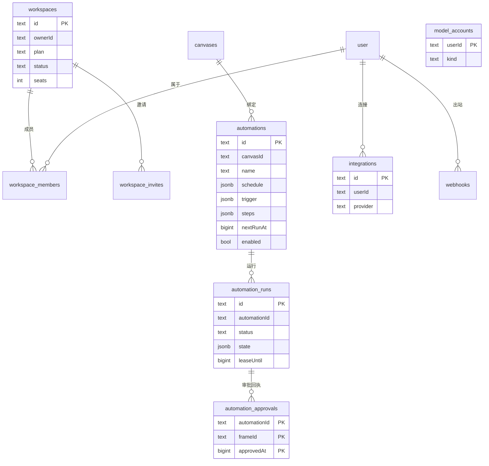

要点：

- `automation_approvals` 的唯一键 `(automationId, frameId, approvedAt)` 是审批派发的幂等凭据。
- `automation_runs.state` 保存冻结的步骤、源 Frame 身份、当前步骤、任务 id、摘要与结果链接；`leaseUntil` 是跨进程互斥手段。
- 集成安装另有 `linear_installations` / `slack_installations` 与对应 session 表，图中省略以避免拥挤。

---

## 9. 关键端到端流程

### 9.1 打开画布

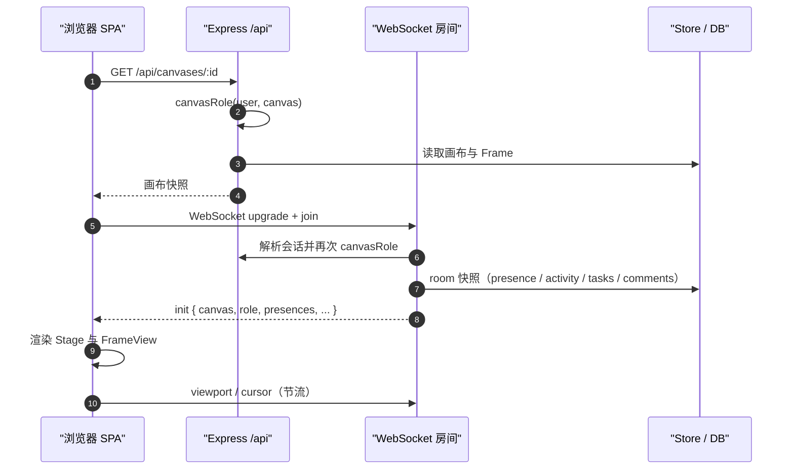

关键点：REST 与 WebSocket 各自做一次权限判定；`join` 之后才收到广播。`init` 是完整快照，没有增量恢复。

### 9.2 协同编辑一个 Frame

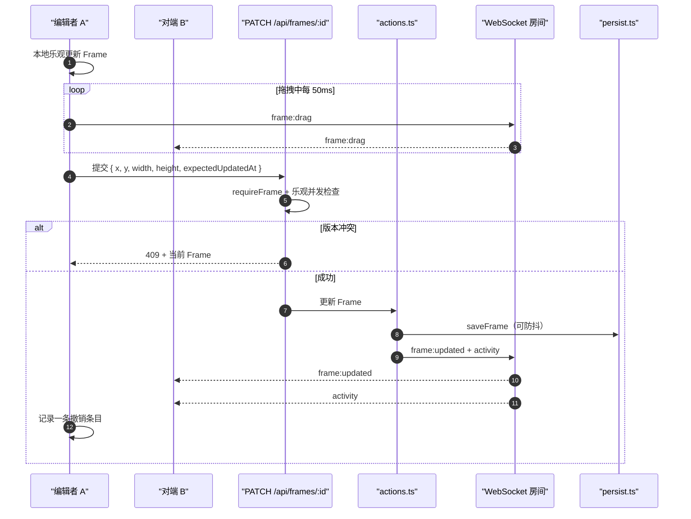

`frame:drag` 只是视觉预告，不改变持久状态；真正的写与广播发生在 REST 提交之后。

### 9.3 Agent 写入 Frame

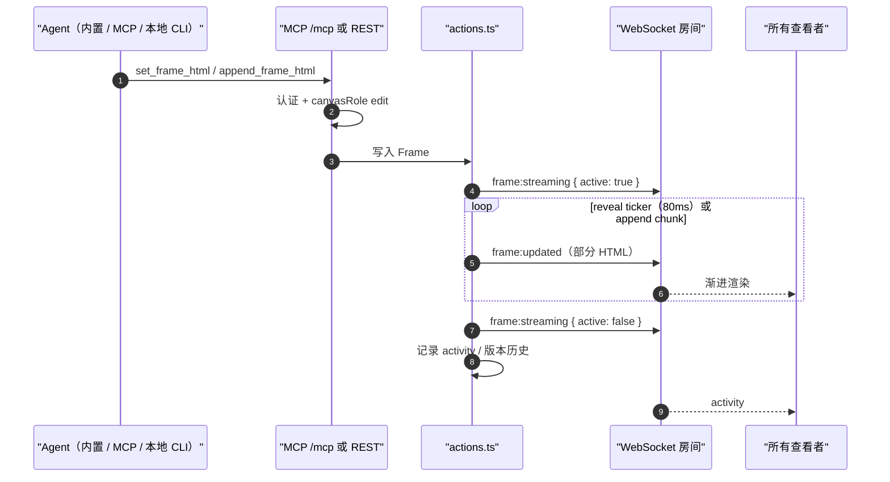

服务端决定每次揭示多少 HTML，因此所有 provider 的流式体验一致。

### 9.4 分享链接的权限校验

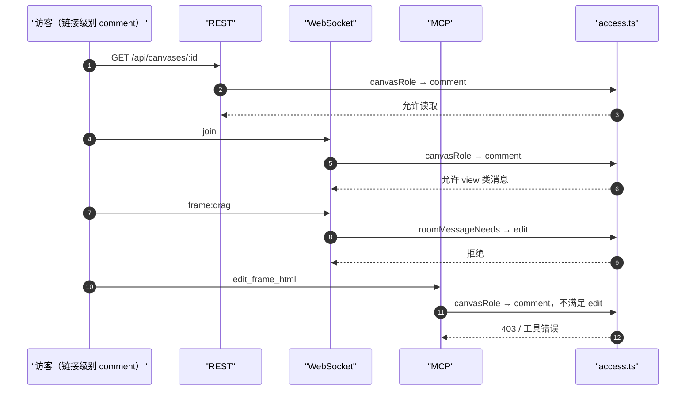

三个入口共用同一判定；`hasDurableCanvasAccess` 进一步把同步密钥等长期能力限制在所有者、成员与工作区成员之内。

### 9.5 PDF 导出

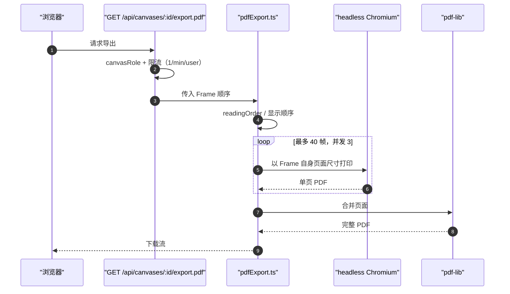

单帧渲染超时 60 秒；浏览器端下载超时由 `shared/pdfLimits.ts` 的同一预算计算，避免两端阈值不一致。

---

## 10. 架构决策与权衡

下表记录当前架构中已经固化、并且会持续影响新代码的决策。每条都给出背景、备选与后果。

| 决策                                    | 背景                                                              | 备选                                      | 后果与约束                                                                                             |
| --------------------------------------- | ----------------------------------------------------------------- | ----------------------------------------- | ------------------------------------------------------------------------------------------------------ |
| 手写路由而非 React Router               | 需要精确控制深链、桌面接管、未登录兜底与 `pushState` 之外的清理   | React Router、TanStack Router             | 无额外依赖、控制力强；代价是匹配逻辑重复、无懒加载、无路由级数据加载                                   |
| 单一全局 Zustand store                  | 画布会话、在场、选择、UI、相机需要被大量组件直接读取              | 分片 store、Redux、服务端缓存             | 读写直接、WS 可薄薄一层写入；代价是 store 变大、返回新数组的 selector 容易破坏 memo                    |
| Frame 用沙箱 iframe + 字符串 runtime    | 必须渲染任意用户 HTML，同时隔离脚本与样式，且支持脚本创建的节点   | 解析进 React 树、Web Components、私有图元 | 隔离彻底、命中测试在浏览器真实布局中完成；代价是父窗口不能直接读 DOM、协议无类型、runtime 不受 TS 检查 |
| 最后写入者胜，无 OT/CRDT                | 目标是设计画布而非协同文档；同一 Frame 的并发细粒度编辑不是主路径 | OT、Yjs/Automerge                         | 实现简单、服务端无合并历史；代价是并发 HTML 编辑会互相覆盖，撤销只能本地                               |
| 协作内容内存优先 + 异步写穿             | 高频 presence、拖拽、流式写入不能等待数据库                       | 全 DB 同步、写前日志                      | 实时路径延迟低；代价是持久化最终一致，崩溃可能丢失防抖窗口内的写入                                     |
| 运营配置 DB 优先                        | 计费、工作区、自动化需要强一致读与事务                            | 全部内存化                                | 语义清晰、易于多副本；代价是请求路径带数据库延迟，两套一致性模型需要开发者明确区分                     |
| MCP 无状态传输，复用 REST mutation 服务 | 外部 Agent 与 REST/内置 Agent 必须行为一致                        | 有状态 MCP 会话、另一套写服务             | 部署简单、权限与广播完全一致；代价是每个请求重建 server，且 MCP 无法依赖会话内状态                     |
| 单一授权模块覆盖 REST / WS / MCP        | 三种入口必须对「谁能做什么」给出同一答案                          | 各入口自行判断                            | 无权限漂移；代价是 `access.ts` 依赖已水合的工作区状态，启动顺序不能错                                  |
| 共享源码目录而非 workspace 包           | 前后端需要同一份协议、角色语义与纯函数，但不想引入构建链          | npm workspace、代码生成、OpenAPI          | 改一处两端立即可见、零构建；代价是无版本边界、无包级依赖约束、Docker 必须复制 `shared/`                |
| Bun 管包/跑脚本，Node 跑服务            | 需要 Bun 的安装速度与脚本体验，同时保持 Node 生态兼容与生产稳定   | 全 Bun、全 Node                           | 开发快、生产稳；代价是双运行时差异需要 CI 同时覆盖（构建用 Bun、运行用 Node）                          |
| Tauri 壳不打包前端、独立版本            | 希望线上发布立即到达桌面用户，且壳的能力可以独立演进              | 内嵌前端、随应用发版                      | 更新即时；代价是壳与页面必须做能力探测，自托管者要改 capabilities 中的 remote URL                      |
| 双 linter + `LEGACY_CHROME` 豁免        | oxlint 快且类型感知，ESLint 仍有不可替代的受限语法规则            | 只用一个 linter                           | 规则覆盖完整；代价是配置分散、编辑器 chrome 长期处于豁免状态                                           |
| 扩展注册表（服务端 + 客户端）           | 集成需要同时提供 OAuth、Webhook、MCP 工具、自动化动作与设置界面   | 核心内硬编码、插件运行时                  | 删除目录即可裁剪；代价是注册表与目录必须手工同步，部分历史钩子未接线                                   |
| Frame 版本按编辑突发保留                | 设计过程需要可恢复的历史，但不应无限增长                          | 每次写入一条版本、Git 式快照              | 存储可控、恢复语义清晰；代价是历史粒度是启发式的，不是严格操作序列                                     |

这些决策之间互相支撑：沙箱 iframe 决定了父窗口不能直接读 DOM，因此需要 postMessage 协议与 frame bridge；内存优先决定了无外键与手工级联；共享源码决定了 `shared/` 必须保持纯契约。修改其中一条时，应同时评估与之绑定的其他决策。

---

## 11. 质量属性与约束

### 11.1 性能

性能设计集中在「高频路径不碰 React、不碰数据库」：

| 路径                 | 手段                                                        |
| -------------------- | ----------------------------------------------------------- |
| 相机平移/缩放        | `useStore.subscribe` 直接写 DOM/CSS 变量，不触发 React 渲染 |
| 点阵、像素网格、标尺 | `<canvas>` 绘制或 CSS 背景，随订阅更新                      |
| 光标/视口广播        | 50ms 节流                                                   |
| Frame 拖拽广播       | 每 Frame 50ms 节流                                          |
| Hover 命中           | 约 40ms 节流，命中 tag/rect 变化才重渲染                    |
| Frame HTML 重投      | `useThrottledValue` 150ms                                   |
| Agent 流式揭示       | 80ms tick，2.5–5 秒完成                                     |
| presence 过期        | 5 秒扫描，Agent TTL 20/60 秒                                |
| 缩略图与预览         | 进程内缓存 + 持久化缩略图 + stale-while-revalidate          |

PDF 与截图的资源预算是显式的：最多 40 帧、并发 3、单帧 60 秒、每用户 1 次/分钟。

### 11.2 安全

| 面           | 机制                                                                                           |
| ------------ | ---------------------------------------------------------------------------------------------- |
| 用户 HTML    | `sandbox="allow-scripts"` 的不透明源 iframe；父窗口不能读取其 DOM                              |
| 桌面 webview | CSP 为 `null`，但导航允许列表把外部链接交给系统浏览器；远程 IPC 只对允许的 origin 开放         |
| 认证         | better-auth；MCP 使用 OAuth 授权服务器或 `dpk_` Agent Key；被禁用用户即使持有有效 token 也 403 |
| 授权         | 单一 `canvasRole`；impersonation 全站只读；durable access 排除分享链接访客                     |
| 密钥         | 只从 `server/env.ts` 读取；ESLint 禁止其他位置访问 `process.env`；本地 CLI 的模型凭据不出本机  |
| SSRF         | 出站 Webhook 校验私有/环回地址并在投递时复查 DNS；OpenRouter/Gemini 使用固定 URL               |
| 上传         | 5 MB 上限、`sharp` 嗅探 MIME、存储 key 白名单兼作路径穿越防护                                  |
| 外部集成     | Stripe 原始字节验签；Linear/Slack OAuth state；Webhook HMAC-SHA256                             |
| 管理面       | 非管理员访问 `/api/admin/*` 返回 404 而不是 403，减少探测信息                                  |

### 11.3 可靠性

- **并发写入**：Frame PATCH 与审批使用 `expectedUpdatedAt`，冲突返回 409 和当前 Frame；Page 替换使用 `expectedPages`。
- **保存顺序**：前端 `trackSave()` 让撤销等待在途写入；每个 Frame 有引用计数的 pending 保存。
- **删除回滚**：绘制转移、Frame 删除与撤销都有「源内容变化则保留副本」的保护。
- **后台任务**：自动化使用条件认领 + 300 秒 lease；审批派发有唯一回执；启动时把中断工作标记为失败。
- **连接恢复**：客户端固定 1200ms 重连并重新 `init`；构建版本变化提示刷新；4401/4403/4404 有明确去向。
- **增删表**：应用表无外键，新增表必须加入 `persist.ts` 的删除路径，否则会留下孤儿行。

### 11.4 可维护性与测试架构

工具链：

- `tsgo`（TypeScript 7 原生编译器）做类型检查，`typescript` 5.x 供编辑器与 ESLint 解析器使用；`tsgo` 不接受 `baseUrl`，因此只保留 `paths`。
- oxlint 承担主规则集（含类型感知规则与 React Compiler/hooks 规则），ESLint 只保留受限语法与 `no-undef`。
- Prettier 统一格式；commitlint 约束提交；husky + lint-staged 在提交前执行。
- `bun run doc-lint` 检查 `CLAUDE.md` 与 `.context` 的索引约定。

测试分四层，均位于 `tests/`（约 180 个文件）：

| 层         | 环境                    | 代表内容                                                                    |
| ---------- | ----------------------- | --------------------------------------------------------------------------- |
| 纯单测     | Node                    | 几何、序列化、页面/排序、权限、桌面协议、frame runtime 源码约束             |
| 组件测试   | happy-dom               | 评论面板、确认弹窗、连接弹窗、安装流程、原型面板                            |
| 服务端集成 | 真实子进程 + PGlite     | `tests/harness.ts` 启动 `tsx server/index.ts`，临时 cwd，HTTP + WebSocket   |
| 浏览器测试 | Vite + `puppeteer-core` | 绘制、元素面板/缩放/右键、Frame 可见性/本地编辑/栅格/回放、页面、原型、标尺 |

服务端集成测试的 `globalSetup` 先构建一个已迁移的 PGlite 模板，每个测试复制它，避免重复迁移。浏览器测试在找不到系统浏览器时自动跳过。

---

## 12. 扩展指南

本节按「你要做什么」组织。每一步都指向应复用的既有设施，避免新代码绕过架构。

### 12.1 新增一个页面或路由

1. 在 `src/pages/` 新建页面组件，使用 `src/components/ui/dash.tsx` 的 `DashLayout` 与 `AppRail` 构建仪表盘外壳，或复用 `CanvasPage` 的画布外壳约定。
2. 在 `src/App.tsx` 增加路径匹配；如需登录后深链，保留原 URL。
3. 导航入口放进 `src/components/AppRail.tsx` 的对应分组；设置类页面使用 `SettingsCard`/`CardRow`。
4. 如需桌面端支持，确认是否需要新的 `view-command` 或深度链接，并同步 `src/lib/shell.ts` 的能力探测。
5. 为新的 UI 原语补 Storybook story；页面不得使用裸表单元素或任意字号/圆角（ESLint 会拒绝）。

### 12.2 新增一个 REST 接口

1. 判断归属：外围域建独立 router 并在 `server/index.ts` 挂载；核心画布域可暂时放在内联路由，但应复用现有 helper。
2. 访问控制必须调用 `requireCanvas` / `requireFrame` 或 `canvasRole`，并显式给出所需角色；`requireCanvas` 的 `need` 参数是必填的，故意让遗漏变成编译错误。
3. 写入必须走 `actions.ts` 或 `store.ts` 的既有 mutation，以便自动获得广播、活动、持久化与版本历史。
4. 请求校验沿用现有风格：核心域手写校验 + 共享解析器，新模块优先 Zod。
5. 如果会改变 Frame 内容或位置，确认是否需要 `expectedUpdatedAt` 乐观并发。
6. 补集成测试：使用 `tests/harness.ts` 的真实服务与 cookie jar。

### 12.3 新增一个 WebSocket 消息

1. 在 `shared/types.ts` 的 `ClientMessage` / `ServerMessage` 联合类型中增加字面量类型。
2. 在 `server/access.ts` 的 `roomMessageNeeds` 中给出最低角色；不要依赖默认的 `edit`。
3. 服务端在 `server/index.ts` 的 WS switch 中处理，并通过 `broadcast` 发送。
4. 客户端在 `src/lib/ws.ts` 的 `handle()` 中写入 store action。
5. 评估多副本与节流：高频消息必须节流，且不要假设房间状态跨进程共享。

### 12.4 新增一个 MCP 工具

1. 在 `server/mcp.ts` 用 `registerTool` 注册，提供 Zod `inputSchema` 与四个 MCP 注解。
2. 访问控制复用 `canvasFor(canvasId, need)` / `frameFor(...)`；只读工具不得领取工作或写入。
3. 写入复用 `actions.ts`，不要另建写路径。
4. 如果工具有对应的 REST 行为，两者必须共享同一 mutation 与权限语义。
5. 在 `tests/` 增加工具级测试，并当心 MCP 与 REST 的工具/接口奇偶性测试。
6. 如果工具属于某个集成，放在扩展的 `registerMcpTools` 中，而不是核心 `mcp.ts`。

### 12.5 新增一个集成

1. 服务端：在 `server/<name>/` 实现 `ServerExtension`（`oauth`、`connectRouter`、`webhookRouter`、`startWorker`、`registerMcpTools`、`mcpGuideLines`、`runAutomationAction`）。
2. 在 `server/extensions.ts` 的注册表中加入；核心只 import 这个注册表。
3. 客户端：在 `src/integrations/<name>.tsx` 提供设置卡片、导入区块、断开行为；在 `src/integrations/index.tsx` 注册。页面遍历注册表，不直接点名 provider。
4. 如需持久化 OAuth 会话，参考 `linear_installations` / `slack_installations` 与对应 session 表，实现可重试的 inbox/outbox worker。
5. 在 `docs/` 增加安装与运维说明。

### 12.6 新增一个 Agent Provider

1. 在 `server/agentModel.ts` 或独立文件中实现 `run(req)` / `runHarness`，内部仍使用 Anthropic 消息形状。
2. 在 `pickModel` 中增加解析分支；注意顺序：云 worker → 本地 CLI → 用户模型账户 → 平台档位。
3. 如需实时模型目录，在 `server/modelCatalog.ts` 增加 loader，并保持「实时目录 + 精选菜单回退」的行为。
4. 如需新的凭据类型，扩展 `model_accounts`、`server/modelAccounts.ts` 与设置界面。
5. 确保流式写入仍通过 `actions.ts`，不要绕过 reveal/append 机制。

### 12.7 新增数据表与迁移

1. 修改 `server/db/schema.ts`（或 `auth-schema.ts`），时间戳使用 epoch 毫秒 `bigint`。
2. 运行 `npx drizzle-kit generate`，提交生成的 SQL 与 journal 变更。
3. 在 `server/db/persist.ts` 增加水合、写穿与删除路径；无外键意味着级联必须手工补齐。
4. 确认 PGlite 与真实 Postgres 都能应用该迁移。
5. 如果表属于「协作内容」，考虑是否应进入内存 Store；如果属于「运营配置」，直接在路由模块查询。

### 12.8 新增画布工具或手势

1. 在 `src/lib/tools.ts` 增加工具与快捷键，并更新 `resolvePointerAction()` 决策表。
2. 世界空间预览放在 `Stage` 的 world 子层，屏幕空间 chrome 放在 `--vx`/`--vy`/`--zoom` 驱动的层。
3. 手势要定义取消路径：Esc、窗口失焦、Frame HTML 变化、选择变化、组件卸载。
4. 需要命中测试时通过 `frameBridge` 发起请求，并处理 2 秒超时与异步回复前的指针缓冲。
5. 提交必须产生一条撤销条目，并使用 `trackSave()` 串行化。

### 12.9 新增 UI 原语

1. 优先使用 shadcn CLI 生成到 `src/components/ui/`，再按设计令牌调整。
2. 使用 `text-*`、`rounded-*`、颜色令牌，不写任意像素值或十六进制颜色。
3. 图标从 `src/components/ui/icons.tsx` 取，不内联第三方 logo（使用 `BrandMark`）。
4. 补 `src/stories/` 的 story；新原语没有 story 视为未完成。

---

## 13. 已知技术债与演进建议

以下问题都能在代码中直接观察到。按「影响新开发的程度」排序。

| 优先级 | 问题                                         | 证据与影响                                                                      | 建议                                                                                                    |
| ------ | -------------------------------------------- | ------------------------------------------------------------------------------- | ------------------------------------------------------------------------------------------------------- |
| 高     | `server/index.ts` 是巨型组合根（约 2373 行） | 进程启动、REST 核心、WebSocket 房间、静态服务混在一起，实时层没有模块边界       | 拆为 `bootstrap.ts`、`routes/canvases.ts`、`routes/frames.ts`、`routes/comments.ts`、`realtime/room.ts` |
| 高     | 前端超大组件                                 | `CanvasPage.tsx` 约 2031 行、`FrameView.tsx` 约 1519 行、`Stage.tsx` 约 1040 行 | 按「WS 生命周期 / 快捷键 / 面板布局 / 手势 / 渲染」拆分，逐步抽出 hooks                                 |
| 高     | postMessage 协议无类型                       | 消息名是散落的字符串字面量，frame runtime 在模板字符串内，不受 TS 检查          | 用共享常量与类型定义消息表；为 runtime 增加源码级契约测试（已有 `frameRuntimeBody` 可扩展）             |
| 高     | 并发编辑采用最后写入者胜                     | 同一 Frame 的并发 HTML 编辑会互相覆盖；撤销只覆盖本地操作                       | 明确产品边界；若需多人同 Frame 协同，再评估细粒度锁或 CRDT                                              |
| 中     | 客户端无数据缓存层                           | 各页面 `useEffect` 拉取，加载/错误/重试重复；mutation 后无统一失效              | 引入轻量查询层（即使不用 React Query）或统一 `useResource` 模式                                         |
| 中     | WebSocket 单通道、固定重连、无消息校验       | 单例连接、1200ms 固定重连、无背压、无事件重放；帧更新与活动共享通道             | 增加指数退避、消息 schema 校验与可选的按类型分通道                                                      |
| 中     | 校验体系双轨                                 | 核心内联路由手写 `typeof`，新模块用 Zod；公开 API 一致性风险                    | 新接口统一 Zod；核心路由逐步迁移                                                                        |
| 中     | 无全局错误中间件与 JSON 404                  | `next(err)` 落到 Express HTML 错误页；未知 `/api` 返回 HTML                     | 增加统一错误中间件与 404 响应                                                                           |
| 中     | 内存态状态与多副本设计并存                   | presence、房间、Agent 队列、限流、Webhook 重试均进程内；自动化却支持多副本      | 文档化单副本假设，或引入房间协调/粘性路由与共享限流                                                     |
| 中     | 编辑器 chrome 未迁移设计系统                 | `LEGACY_CHROME` 豁免大量文件，任意字号/圆角/裸元素仍存在                        | 按面板逐个迁移，禁止新增豁免                                                                            |
| 中     | 响应式断点双处维护                           | CSS `--breakpoint-md` 与 `src/hooks/use-mobile.ts` 的 `MOBILE_QUERY` 手工同步   | 生成一份断点常量或在构建时注入                                                                          |
| 低     | Frame 内容双源一致性                         | store 中的 `frame.html` 与 iframe 实时 DOM 需要持续调和                         | 明确「保存快照」与「运行文档」的边界，减少父窗口解析 HTML 的场景                                        |
| 低     | 扩展 API 存在未接线钩子                      | `ServerExtension.canvasRouter`、`runAutomationPull` 无调用点                    | 删除或补上挂载点，避免误导扩展作者                                                                      |
| 低     | 手写路由重复                                 | 路径匹配散落在 `App.tsx`、`CanvasPage`、桌面模块                                | 抽出小型路由匹配工具，至少统一参数解析                                                                  |
| 低     | 无前端懒加载                                 | 所有页面进入初始 bundle                                                         | 对非画布页面按路由动态 import，画布保持首屏优先                                                         |

演进建议的原则：先拆组合根与超大组件，再补协议类型与错误边界，最后才考虑引入新的框架级依赖。当前架构的主要风险不是缺少抽象，而是少数文件承担了过多职责，使边界只能靠记忆维持。

---

## 14. 附录

### 14.1 术语表

| 术语           | 英文 / 代码名         | 说明                                         |
| -------------- | --------------------- | -------------------------------------------- |
| 画布           | Canvas                | 权限、协作、房间的边界                       |
| 页面           | Page                  | 画布内的分组                                 |
| 画板 / 画框    | Frame                 | 承载一段 HTML 的矩形区域                     |
| 图层 / 元素    | Layer / Element       | Frame HTML 内的 DOM 节点                     |
| 分享链接级别   | Link Access           | `none` / `view` / `comment` / `edit`         |
| 画布角色       | Canvas Role           | `view` / `comment` / `edit`                  |
| 常驻 Agent     | Resident Agent        | 服务端内置设计 Agent                         |
| 看板卡片       | Card                  | 交给 Agent 的工作单元                        |
| 设计记忆       | Design Memory         | guidelines、references、decisions、proposals |
| 原型           | Prototype             | 通过 `data-doop-*` 属性定义的交互            |
| 自动化         | Automation            | 定时或审批触发的多步骤工作流                 |
| 审批           | Approval              | Frame 的人工签核状态                         |
| 设计同步       | Design Sync / Ingest  | 嵌入脚本上报真实页面结构                     |
| durable access | Durable Canvas Access | 所有者/成员/工作区成员，排除分享链接访客     |

### 14.2 关键文件索引

| 关注点                   | 文件                                                                                                                                  |
| ------------------------ | ------------------------------------------------------------------------------------------------------------------------------------- |
| 服务端组合根 / HTTP / WS | `server/index.ts`                                                                                                                     |
| 环境变量                 | `server/env.ts`                                                                                                                       |
| 访问控制                 | `server/access.ts`、`shared/canvasRole.ts`                                                                                            |
| 内存状态                 | `server/store.ts`                                                                                                                     |
| mutation / 广播 / 流式   | `server/actions.ts`                                                                                                                   |
| 持久化与水合             | `server/db/persist.ts`                                                                                                                |
| 数据库初始化与迁移       | `server/db/index.ts`、`server/db/migrations/`                                                                                         |
| 应用 schema              | `server/db/schema.ts`、`server/db/auth-schema.ts`                                                                                     |
| 认证                     | `server/auth.ts`                                                                                                                      |
| MCP Server               | `server/mcp.ts`、`server/chatgptApp.ts`                                                                                               |
| 内置 Agent               | `server/resident.ts`、`server/agentModel.ts`                                                                                          |
| Provider 适配            | `server/openaiAgent.ts`、`server/chatCompletionsAgent.ts`、`server/localAgent*.ts`、`server/geminiCloud*.ts`                          |
| 模型账户与目录           | `server/modelAccounts.ts`、`server/modelCatalog.ts`                                                                                   |
| 自动化                   | `server/automations.ts`、`shared/automations.ts`                                                                                      |
| 集成扩展                 | `server/extensions.ts`、`server/linear/`、`server/slack/`                                                                             |
| 出站 Webhook             | `server/webhooks.ts`、`server/webhookRoutes.ts`                                                                                       |
| 资源与存储               | `server/assets.ts`、`server/storage.ts`                                                                                               |
| 截图与 PDF               | `server/screenshot.ts`、`server/pdfExport.ts`                                                                                         |
| 前端入口                 | `index.html`、`src/main.tsx`、`src/App.tsx`                                                                                           |
| 前端状态                 | `src/lib/store.ts`、`src/lib/api.ts`、`src/lib/ws.ts`                                                                                 |
| 画布渲染                 | `src/components/Stage.tsx`、`src/components/FrameView.tsx`                                                                            |
| Frame runtime / 桥       | `src/lib/frameRuntime.ts`、`src/lib/frameBridge.ts`                                                                                   |
| 手势与历史               | `src/components/CanvasDrawing.tsx`、`src/components/ElementMove.tsx`、`src/components/ElementResizeHandles.tsx`、`src/lib/history.ts` |
| 设计系统                 | `src/components/ui/`、`src/styles.css`、`src/stories/`                                                                                |
| 桌面壳                   | `desktop/src-tauri/src/main.rs`、`claude.rs`、`codex.rs`、`view_menu.rs`                                                              |
| 共享契约                 | `shared/types.ts` 及其余 `shared/*.ts`                                                                                                |
| 测试                     | `tests/harness.ts`、`tests/globalSetup.ts`、`tests/fixtures/`                                                                         |
| CI / 发布                | `.github/workflows/ci.yml`、`desktop.yml`、`desktop-release.yml`、`release-please.yml`                                                |
| 容器化                   | `Dockerfile`、`docker-compose.yml`                                                                                                    |

### 14.3 常用命令

```bash
bun install                 # 安装依赖
bun run dev                 # 零配置开发：tsx watch + vite + 扩展构建
bun run build               # 构建前端到 dist/
bun run start               # 生产模式启动服务端（Node + tsx）
bun run test                # vitest run
bun run typecheck           # tsgo --noEmit
bun run lint                # oxlint + eslint
bun run format              # prettier --write
bun run format:check        # prettier --check
bun run doc-lint            # 文档索引约定检查
bun run storybook           # 组件目录 :6006
docker compose up           # 自托管：app :4400 + Postgres 16
```

### 14.4 维护建议

- 目录结构、模块边界、WS/MCP 协议、数据表或部署形态变化时，更新对应章节，而不是在文末追加补丁。
- 新增技术债时，优先写进第 13 章并给出证据文件；债项被解决后删除对应行。
- 本文不复制 `.context/TECHSTACK.md` 的依赖清单；版本变化只需更新顶部「适用版本」。
- 如果未来引入路由库、查询缓存、CRDT 或新的运行时，第 10 章的决策表必须同步修订，因为它们是本文其他章节的前提。

---

_本文基于当前代码快照编写。代码是事实来源；发现不一致时，请以代码为准并更新本文。_
